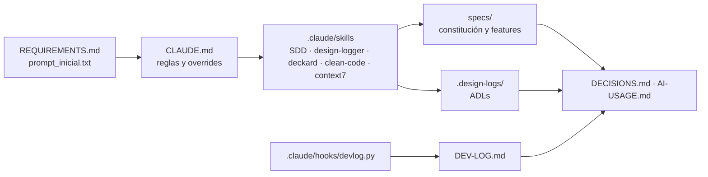

# AI-USAGE · DroiDesk

Cómo se usó IA para construir DroiDesk: herramientas, cómo se estructuraron el contexto y las reglas, qué se delegó, dónde intervino el humano y qué salidas se rechazaron. Cada interacción está registrada en [DEV-LOG.md](DEV-LOG.md); las decisiones de producto y arquitectura, en [DECISIONS.md](DECISIONS.md) y [`.design-logs/`](.design-logs/).

## 1. Herramientas

| Herramienta | Rol | Uso en el proyecto |
|---|---|---|
| **Claude Code · Opus 5.5, esfuerzo max** | Sesión principal: planificación | Constitución, specs, clarify, plan, tasks, ADLs, orquestación, revisión y documentación |
| **Claude Code · Sonnet 5.5, esfuerzo xHigh** | Subagentes de coding | Cada bloque de implementación se delega con un prompt autocontenido: tareas, rutas, contratos y reglas |
| [**spec-driven-dev**](.claude/skills/spec-driven-dev/SKILL.md) | Metodología | Constitution → Specify → Clarify → Plan → Tasks → Implement → Replanning, con artefactos en `specs/` |
| [**design-logger**](.claude/skills/design-logger/SKILL.md) | Memoria técnica | Un ADL por decisión de arquitectura, librería, datos o seguridad en `.design-logs/` |
| [**deckard**](.claude/skills/deckard/SKILL.md) ([agente](.claude/agents/deckard.md)) | Revisión Clean Code | Checkpoint de cada bloque; un hallazgo de criticidad ≥ 8 bloquea el commit |
| **clean-code**: [`python-clean-code`](.claude/skills/python-clean-code/SKILL.md), `clean-*`, [`boy-scout`](.claude/skills/boy-scout/SKILL.md) | Estándar de código | Reglas que aplican los subagentes al escribir y deckard al revisar |
| [**context7**](.claude/skills/context7/SKILL.md) | Documentación vigente | `npx ctx7@latest` antes de usar la API de cada librería, para no depender de lo que el modelo recuerda |
| **graft** | Navegación de código | Grafo de símbolos y llamadas, vía MCP o CLI (`graft ask`, `graft skeleton`), que reemplaza grep y lecturas de archivos completos; `graft stats` mide los tokens ahorrados |
| **rtk** | Ahorro de tokens en shell | Hook global `PreToolUse:Bash` que reescribe los comandos (`git status` → `rtk git status`) y comprime su salida |
| [**prompt-cache-control**](.claude/skills/prompt-cache-control/README.md) | Costo y latencia | Mod de claude-code-templates que muestra el hit rate del prompt cache, una cuenta regresiva hasta su vencimiento y avisa cuándo conviene `/compact` |

## 2. Cómo se estructuraron el contexto y las reglas

- **[`CLAUDE.md`](CLAUDE.md)** fija el idioma, el flujo por bloque, git, el reparto de modelos y las herramientas. Cuando contradice a una skill, manda `CLAUDE.md`: aprobación por bloque en vez de por sub-tarea, y una rama por fase en vez de push directo a `main`.
- **Skills versionadas en el repo** (`.claude/skills/`): quien clone el repo trabaja con las mismas reglas. La copia de deckard se adaptó para leer los ADL de `.design-logs/` y las skills clean-code del repo. Su agente delega en la skill para no duplicar las reglas.
- **Hooks**: el del repo escribe [DEV-LOG.md](DEV-LOG.md). Los globales del usuario ejecutan deckard al terminar cada turno con cambios de código, rtk en cada comando de shell y graft.
- **Memoria**: las correcciones del usuario sobre la forma de trabajar se guardan como memoria de feedback del agente.
- **Reparto de modelos**: la sesión principal nunca cambia de modelo, porque cambiarlo invalida el prompt cache. El coding va en subagentes Sonnet, cada uno con su propio contexto. El esfuerzo max se fija por sesión con `/model`: después de reiniciar hay que volver a fijarlo.

## 3. Qué se delegó por completo al agente

| Fase | Tarea | Modelo |
|---|---|---|
| 1 · Bootstrap IA | Hook de DEV-LOG: script, tests y registro en `.claude/settings.json`, a partir de una especificación cerrada | Sonnet 5.5 xHigh |
| 1 · Bootstrap IA | Revisión Clean Code del hook y corrección de sus 2 hallazgos de criticidad 8 | Sonnet 5.5 xHigh (deckard) |
| 1 · Bootstrap IA | Copia y adaptación de skills, instalación de prompt-cache-control, `CLAUDE.md` y `.gitignore` | Opus 5.5 Max |
| 1 · Constitución | `specs/mission.md`, `tech-stack.md`, `roadmap.md` y ADL-001 a ADL-007, a partir de las 5 respuestas del usuario | Opus 5.5 Max |

## 4. Dónde intervino el humano y por qué

| Momento | Intervención | Efecto |
|---|---|---|
| Preguntas iniciales | Rechazó el cuestionario para aclarar dudas antes de responder | Se reformularon las preguntas con más contexto ([DEV-LOG #1](DEV-LOG.md)) |
| Alcance opcional | Propuso SLA + Adjuntos y pidió una segunda opinión | Tras la recomendación eligió SLA + Comentarios ([DEV-LOG #2](DEV-LOG.md), [criterio](DECISIONS.md#alcance-opcional)) |
| Constitución | Cambió la meta de cobertura propuesta (90 % en la API y 70 % en la web) por Pareto 80/20: 80 % total y 90 % en el flujo crítico | Nuevo [ADL-007](.design-logs/ADL-007-pareto-coverage-gates.md) y gates en `CLAUDE.md` y `tech-stack.md` |
| Clarify de la feature 001 | Respondió las 5 preguntas: prioridad sugerida por el solicitante y ajustable por el agente, pausa del SLA en espera, reactivación al comentar, cancelación solo desde Abierto y plazos por prioridad | Spec sin ambigüedades y [ADL-008](.design-logs/ADL-008-ticket-lifecycle-six-states.md) con el ciclo de vida |
| Revisión del SLA | Cambió de opinión sobre los plazos aceptados (4, 8, 24 y 72 h corridas): tiempo hábil de lunes a viernes, de 09:00 a 18:00, para un equipo chico. Lo urgente sigue corto (Crítica 4 h y Alta 1 día hábil) y Media y Baja se alargan a 3 y 5 días hábiles | Se reabrió la respuesta 5 de Clarify; spec, constitución y deuda técnica (feriados) actualizadas |

## 5. Qué salidas del agente se rechazaron

| Salida | Motivo |
|---|---|
| Primer cuestionario de 4 preguntas | El usuario necesitaba aclarar las opcionales antes de responder |

## 6. graft, rtk, prompt-cache-control y context7 en la práctica

- **graft**: indexa el repo y responde "dónde está X / quién llama a Y" con el código inline, sin leer archivos enteros. En el bootstrap no había código de la app que indexar y sus herramientas MCP no quedaron expuestas en la sesión, así que se usa por CLI y por sus hooks globales; entra de lleno desde la Fase 2.
- **rtk**: activo desde el primer comando del proyecto vía hook global; el ahorro acumulado se mide con `rtk gain`.
- **prompt-cache-control**: instalado en la Fase 1 con `npx claude-code-templates@latest --mod observability/prompt-cache-control`. Las métricas de cache de cada turno (leída, escrita, hit rate) quedan también en DEV-LOG.
- **context7**: obligatorio antes de escribir código contra FastAPI, SQLModel, Alembic, React o Vite; las consultas quedan registradas en DEV-LOG como comandos `ctx7`. En la constitución se usó, junto con los registros de npm y PyPI, para confirmar las versiones vigentes antes de fijar el stack (Vite 8, TypeScript 7, SQLAlchemy 2.1).
