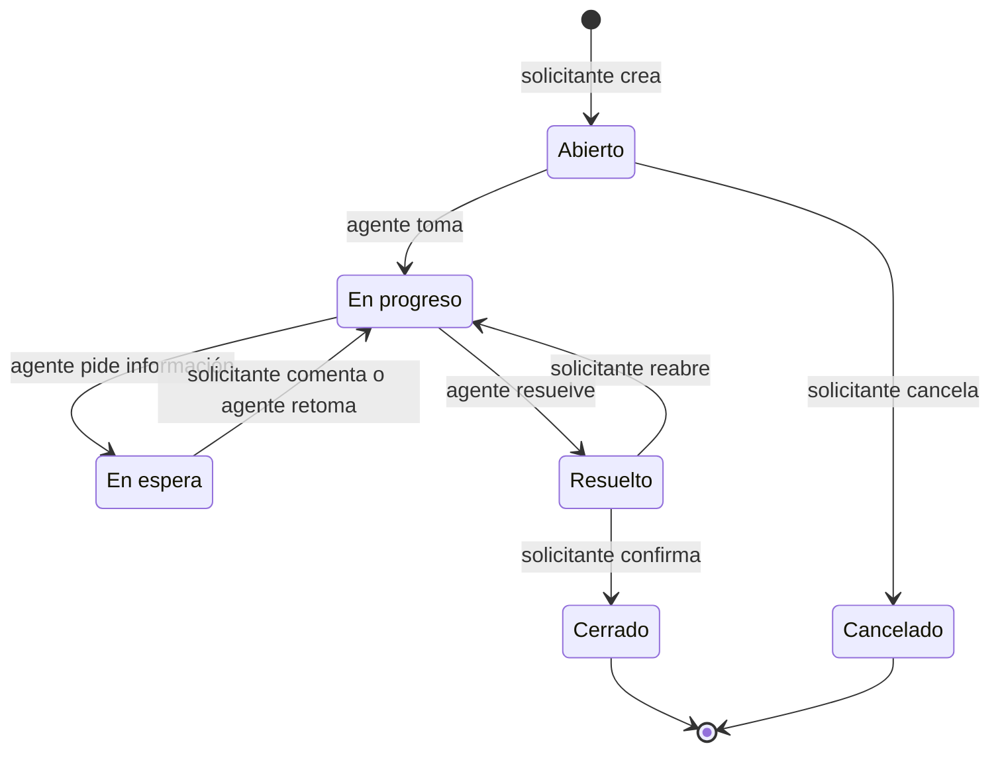

# DECISIONS · DroiDesk

Decisiones de producto y arquitectura del MVP, en versión breve. El detalle técnico vive en los ADL de [`.design-logs/`](.design-logs/) y en los artefactos SDD de [`specs/`](specs/). La conversación que originó cada decisión está en [DEV-LOG.md](DEV-LOG.md).

## Arquitectura y stack

| Decisión | Resumen | ADL |
|---|---|---|
| Dos apps independientes | `apps/api` y `apps/web`, unidas solo por `contracts/openapi.json` | [ADL-001](.design-logs/ADL-001-two-apps-openapi-contract.md) |
| API | Python 3.14, FastAPI, SQLModel y Alembic; el dominio en funciones puras | [ADL-002](.design-logs/ADL-002-fastapi-sqlmodel-backend.md) |
| Base de datos | SQLite en el MVP, con código portable para pasar a PostgreSQL | [ADL-003](.design-logs/ADL-003-sqlite-mvp-postgres-path.md) |
| Web | SPA en React, Vite y TypeScript, con tipos generados del contrato | [ADL-004](.design-logs/ADL-004-react-vite-spa.md) |
| Ingreso | Simulado: se elige un usuario precargado y la API emite un token firmado; el rol se lee de la base de datos | [ADL-005](.design-logs/ADL-005-simulated-auth-signed-token.md) |
| Despliegue | Docker Compose, nginx como proxy de mismo origen y `./setup.sh` como único comando | [ADL-006](.design-logs/ADL-006-docker-compose-same-origin.md) |

La visión del sistema completo está en [`specs/tech-stack.md`](specs/tech-stack.md).

## Máquina de estados del ticket

| Estado | Por qué existe |
|---|---|
| Abierto | Hace visible lo que nadie tomó: "¿quién la tiene?" tiene respuesta incluso cuando es "nadie" |
| En progreso | El ticket tiene un dueño explícito: el agente que lo tomó |
| En espera | La pelota está del lado del solicitante: el SLA se pausa para medir solo lo que depende de soporte |
| Resuelto | El agente da la solución por lista; el tiempo de resolución se mide sin esperar la confirmación |
| Cerrado | El solicitante confirma: el ciclo termina con la voz de quien pidió ayuda |
| Cancelado | El solicitante retira un pedido que nadie tomó, sin ensuciar la cola ni el cumplimiento del SLA |

Solo el agente asignado mueve un ticket tomado, porque no hay reasignación. Si el solicitante comenta un ticket En espera, este vuelve solo a En progreso. Reabrir un ticket no reinicia su plazo. El detalle y las alternativas descartadas están en [ADL-008](.design-logs/ADL-008-ticket-lifecycle-six-states.md) y en la [spec](specs/001-ticketing-mvp/spec.md#clarifications).

## Alcance opcional

El enunciado permite elegir a lo más dos funcionalidades opcionales. El criterio de selección, en orden de peso:

1. **Ataca el problema declarado**: la gestión vive en correo y planillas, y nadie sabe cuántas solicitudes hay abiertas, cuánto demoran ni quién las tiene.
2. **Bajo costo para un MVP**: se apoya en datos que el alcance mínimo ya registra (estados, historial y fechas), sin infraestructura nueva.
3. **Bajo riesgo**: sin dependencias externas ni superficie de seguridad nueva.

### Elegidas

| Funcionalidad | Por qué |
|---|---|
| **SLA por prioridad** | Responde "¿cuánto demoran?": el tiempo transcurrido pasa a ser un compromiso por prioridad, con fecha de vencimiento y un estado (en plazo, por vencer, vencido). El plazo corre en tiempo hábil (lunes a viernes, de 09:00 a 18:00), porque el equipo de soporte es chico: Crítica 4 horas hábiles y Alta 1 día hábil, porque es lo que más afecta al usuario; Media 3 días y Baja 5 días hábiles. La cola deja de ser una lista plana y el agente atiende primero lo que está por vencer. Además, prepara el escenario de 5 áreas de soporte, donde cada área tendrá su propia política de SLA. |
| **Comentarios** | Saca la conversación del correo, que es la mitad del problema: las aclaraciones entre solicitante y agente quedan dentro del ticket y en su trazabilidad. También hacen viable el estado "En espera del solicitante": sin un canal en el ticket, el solicitante no sabría qué se le pide. |

El alcance mínimo ya responde "¿quién la tiene?" (un agente toma el ticket) y "¿qué pasó y cuándo?" (trazabilidad). Estas dos opcionales cubren lo que falta: el tiempo y la conversación.

### Descartadas

| Funcionalidad | Criterio de descarte |
|---|---|
| Adjuntos | Se evaluó como alternativa a Comentarios: aclara el problema al crear el ticket, pero no permite pedir información después. Suma almacenamiento, límites de tamaño y tipo, archivos maliciosos y control de descarga. En el MVP se mitiga pegando un enlace a la evidencia en la descripción o en un comentario. Es el primer candidato post-MVP. |
| Notificaciones | Requiere infraestructura de correo y procesos asíncronos. En el MVP, el solicitante ve el estado y los comentarios nuevos al entrar a sus tickets. |
| Reasignación | Tomar un ticket cubre la asignación básica. Reasignar entre agentes agrega flujo y permisos que no atacan el problema declarado. |
| Dashboard de métricas | La cola ya muestra cuántos tickets hay abiertos, quién los tiene y su estado de SLA. Un dashboard agregado gana valor con volumen y con varias áreas. |
| Búsqueda y filtros | Con el volumen del MVP basta la cola ordenada por vencimiento. Se vuelve necesaria a escala. |
| Categorización automática | Depende de un servicio externo (un LLM con API key), suma costo y vuelve no deterministas los tests. El solicitante elige la categoría al crear el ticket. |

## Estrategia de calidad

Pareto 80/20: cada app debe tener al menos 80 % de cobertura total y el flujo crítico al menos 90 %. El flujo crítico es el ciclo de vida del ticket (crear → tomar → cambiar estado → historial), con sus reglas de SLA y la autorización por rol. El esfuerzo va donde un error rompe la promesa central de DroiDesk; la configuración, el arranque y los componentes visuales quedan cubiertos por el piso del 80 % ([ADL-007](.design-logs/ADL-007-pareto-coverage-gates.md), [detalle](specs/tech-stack.md#quality-strategy)). El balance de qué se probó y qué no se completa en la fase de empaquetamiento.

## Deuda técnica asumida

| Deuda | Por qué se acepta en el MVP | Cuándo se paga |
|---|---|---|
| Ingreso simulado: cualquiera puede entrar como cualquier usuario | El enunciado lo permite y la frontera de autorización ya es real ([ADL-005](.design-logs/ADL-005-simulated-auth-signed-token.md)) | Al integrar el proveedor de identidad de la organización |
| SQLite admite un solo escritor a la vez | Basta para el volumen del MVP ([ADL-003](.design-logs/ADL-003-sqlite-mvp-postgres-path.md)) | Al migrar a PostgreSQL (plan de escalabilidad) |
| Las migraciones corren al iniciar la API | Hay una sola instancia ([ADL-006](.design-logs/ADL-006-docker-compose-same-origin.md)) | Al tener más de una réplica |
| El calendario del SLA no considera feriados | Un feriado entre semana cuenta como día hábil: el error es acotado y evita mantener un calendario de feriados en el MVP | Al cargar el calendario de feriados de la organización (plan de escalabilidad) |
