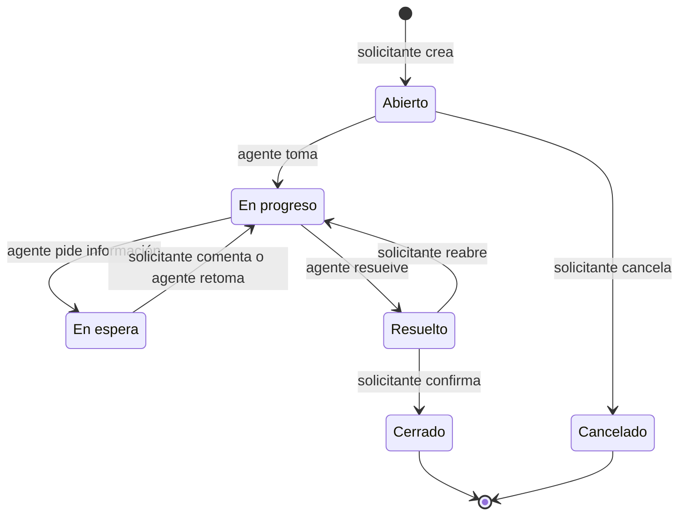

# DECISIONS · DroiDesk

Decisiones de producto y arquitectura del MVP, en versión breve. El detalle técnico vive en los ADL de [`.design-logs/`](.design-logs/) y en los artefactos SDD de [`specs/`](specs/). La conversación que originó cada decisión está en [DEV-LOG.md](DEV-LOG.md).

## Arquitectura y stack

| Decisión | Resumen | ADL |
|---|---|---|
| Dos apps independientes | `apps/api` y `apps/web`, unidas solo por `contracts/openapi.json` | [ADL-001](.design-logs/ADL-001-two-apps-openapi-contract.md) |
| API | Python 3.14, FastAPI, SQLModel y Alembic; el dominio en funciones puras | [ADL-002](.design-logs/ADL-002-fastapi-sqlmodel-backend.md) |
| Base de datos | SQLite en el MVP, con código portable para pasar a PostgreSQL | [ADL-003](.design-logs/ADL-003-sqlite-mvp-postgres-path.md) |
| Web | SPA en React, Vite y TypeScript, con tipos generados del contrato | [ADL-004](.design-logs/ADL-004-react-vite-spa.md) |
| Ingreso | Simulado: un login de usuarios precreados por perfil que acepta cualquier contraseña, con un ícono "?" que lista los usuarios de demo; la API emite un token firmado y el rol se lee de la base de datos | [ADL-005](.design-logs/ADL-005-simulated-auth-signed-token.md) |
| Despliegue | Docker Compose, nginx como proxy de mismo origen y `./setup.sh` como único comando | [ADL-006](.design-logs/ADL-006-docker-compose-same-origin.md) |
| SLA en tiempo hábil | Calendario propio de funciones puras: el vencimiento se guarda para ordenar la cola y el estado se deriva al leer | [ADL-009](.design-logs/ADL-009-sla-business-time.md) |
| Escalamiento | Monolito modular sobre PostgreSQL, con áreas, SSO, paginación y un worker, elegido entre tres estrategias ([SCALABILITY.md](SCALABILITY.md)) | [ADL-011](.design-logs/ADL-011-scale-modular-monolith-postgres.md) |
| Smoke end-to-end | Playwright Test en un módulo `e2e/` propio: el recorrido principal con dos perfiles contra el stack Docker, también en CI | [ADL-010](.design-logs/ADL-010-playwright-e2e-smoke.md) |

La visión del sistema completo está en [`specs/tech-stack.md`](specs/tech-stack.md).

## Modelo de datos

Seis tablas: `users`, `categories`, `sla_policies`, `tickets`, `ticket_events` y `comments` ([detalle](specs/001-ticketing-mvp/data-model.md)).

| Decisión | Por qué |
|---|---|
| `tickets` guarda el estado actual y `ticket_events` la historia, append-only | La cola se consulta rápido sobre una sola tabla indexada, y la trazabilidad no depende de reconstruir estados: cada hecho queda escrito una vez y nunca cambia |
| Cada cambio y su evento se escriben en la misma transacción | El historial no puede quedar desalineado con el ticket |
| Comentarios en su propia tabla, enlazados desde su evento `commented` | La conversación se lee directo, y el historial la muestra en su lugar cronológico |
| El ticket guarda `sla_due_at` y `sla_paused_minutes`; el estado del SLA no se guarda | El vencimiento ordena la cola en la base; el estado derivado al leer nunca queda desactualizado |
| La política de SLA guarda el plazo en la unidad del negocio (`hours` o `days`) | "1 día hábil" sigue siendo una jornada aunque cambie el horario |
| Enums como texto, fechas en UTC y SQL portable | El mismo esquema y las mismas migraciones sirven para PostgreSQL ([ADL-003](.design-logs/ADL-003-sqlite-mvp-postgres-path.md)) |
| Tomar y cancelar como actualizaciones condicionales | Dos agentes nunca quedan asignados al mismo ticket, sin locks explícitos |

## Máquina de estados del ticket

| Estado | Por qué existe |
|---|---|
| Abierto | Hace visible lo que nadie tomó: "¿quién la tiene?" tiene respuesta incluso cuando es "nadie" |
| En progreso | El ticket tiene un dueño explícito: el agente que lo tomó |
| En espera | La pelota está del lado del solicitante: el SLA se pausa para medir solo lo que depende de soporte |
| Resuelto | El agente da la solución por lista; el tiempo de resolución se mide sin esperar la confirmación |
| Cerrado | El solicitante confirma: el ciclo termina con la voz de quien pidió ayuda |
| Cancelado | El solicitante retira un pedido que nadie tomó, sin ensuciar la cola ni el cumplimiento del SLA |

Solo el agente asignado mueve un ticket tomado, porque no hay reasignación. Si el solicitante comenta un ticket En espera, este vuelve solo a En progreso. Reabrir un ticket no reinicia su plazo. Cada transición es una actualización condicional sobre el estado de origen: si dos personas actúan a la vez, solo una gana y la otra recibe un 409 con un mensaje claro. El detalle y las alternativas descartadas están en [ADL-008](.design-logs/ADL-008-ticket-lifecycle-six-states.md) y en la [spec](specs/001-ticketing-mvp/spec.md#clarifications).

## Alcance opcional

El enunciado permite elegir a lo más dos funcionalidades opcionales. El criterio de selección, en orden de peso:

1. **Ataca el problema declarado**: la gestión vive en correo y planillas, y nadie sabe cuántas solicitudes hay abiertas, cuánto demoran ni quién las tiene.
2. **Bajo costo para un MVP**: se apoya en datos que el alcance mínimo ya registra (estados, historial y fechas), sin infraestructura nueva.
3. **Bajo riesgo**: sin dependencias externas ni superficie de seguridad nueva.

### Elegidas

| Funcionalidad | Por qué |
|---|---|
| **SLA por prioridad** | Responde "¿cuánto demoran?": el tiempo transcurrido pasa a ser un compromiso por prioridad, con fecha de vencimiento y un estado (en plazo, por vencer, vencido). El plazo corre en tiempo hábil (lunes a viernes, de 09:00 a 18:00), porque el equipo de soporte es chico: Crítica 4 horas hábiles y Alta 1 día hábil, porque es lo que más afecta al usuario; Media 3 días y Baja 5 días hábiles. La cola deja de ser una lista plana y el agente atiende primero lo que está por vencer. Además, prepara el escenario de 5 áreas de soporte, donde cada área tendrá su propia política de SLA. |
| **Comentarios** | Saca la conversación del correo, que es la mitad del problema: las aclaraciones entre solicitante y agente quedan dentro del ticket y en su trazabilidad. También hacen viable el estado "En espera del solicitante": sin un canal en el ticket, el solicitante no sabría qué se le pide. |

El alcance mínimo ya responde "¿quién la tiene?" (un agente toma el ticket) y "¿qué pasó y cuándo?" (trazabilidad). Estas dos opcionales cubren lo que falta: el tiempo y la conversación.

### Descartadas

| Funcionalidad | Criterio de descarte |
|---|---|
| Adjuntos | Se evaluó como alternativa a Comentarios: aclara el problema al crear el ticket, pero no permite pedir información después. Suma almacenamiento, límites de tamaño y tipo, archivos maliciosos y control de descarga. En el MVP se mitiga pegando un enlace a la evidencia en la descripción o en un comentario. Es el primer candidato post-MVP. |
| Notificaciones | Requiere infraestructura de correo y procesos asíncronos. En el MVP, el solicitante ve el estado y los comentarios nuevos al entrar a sus tickets. |
| Reasignación | Tomar un ticket cubre la asignación básica. Reasignar entre agentes agrega flujo y permisos que no atacan el problema declarado. |
| Dashboard de métricas | La cola ya muestra cuántos tickets hay abiertos, quién los tiene y su estado de SLA. Un dashboard agregado gana valor con volumen y con varias áreas. |
| Búsqueda y filtros | Con el volumen del MVP basta la cola ordenada por vencimiento, y buscar texto exige índices y parámetros nuevos en la API. Al revisar el SLA, el usuario pidió filtrar y ordenar por prioridad y estado del SLA: se agregó como complemento del SLA (FR-024a), en la web y sin ampliar el contrato. La búsqueda de texto y los filtros por categoría, persona o fecha siguen descartados y se vuelven necesarios a escala. |
| Categorización automática | Depende de un servicio externo (un LLM con API key), suma costo y vuelve no deterministas los tests. El solicitante elige la categoría al crear el ticket. |

## Estrategia de calidad

Pareto 80/20: cada app debe tener al menos 80 % de cobertura total y el flujo crítico al menos 90 % ([ADL-007](.design-logs/ADL-007-pareto-coverage-gates.md), [detalle](specs/tech-stack.md#quality-strategy)).
- **Flujo crítico**: el ciclo de vida del ticket (crear → tomar → cambiar estado → historial), con sus reglas de SLA y la autorización por rol.
- **Por qué ahí**: un error en esa parte rompe la promesa central de DroiDesk, que es saber quién tiene cada ticket, qué pasó y si se cumple el plazo.
- Los gates corren en cada checkpoint y en CI; un PR no se integra si alguno falla.

### Qué se probó

| Capa | Qué | Cómo |
|---|---|---|
| Dominio | La tabla completa de transiciones por estado, rol y relación con el ticket; el calendario hábil con sus bordes (fuera de jornada, cruces de cierre y de fin de semana, pausas); el estado del SLA | pytest unitario, con reloj controlado |
| API | Cada endpoint: autorización por rol (403), tickets ajenos (404), validación (422, ids fuera de rango incluidos), transiciones inválidas (409) y el historial escrito en la misma transacción | pytest con TestClient y SQLite temporal |
| Concurrencia | Dos agentes toman el mismo ticket, o se cruzan una transición y un comentario: gana uno y el otro recibe un 409 claro | Tests con hilos sobre SQLite real |
| Datos | Las migraciones coinciden con los modelos; el seed es idempotente y deja los mismos estados de SLA en 6 momentos de la semana | `alembic check` en CI y tests del seed |
| Contrato | El OpenAPI versionado coincide con el que genera la API, y los tipos de la web con el OpenAPI | CI de cada app |
| Web | Guardas por rol, sesión vencida, formularios con sus límites, listados con filtros y orden, acciones según lo que permite la API, avisos de conflicto, comentarios y respuestas citadas, luces de estado y SLA | Vitest y Testing Library, con la API simulada |
| Integración | Crear → tomar → en espera → comentar → resolver → cerrar, con dos perfiles en el navegador, sin errores de consola ni de CSP | Playwright contra el stack Docker, en CI ([ADL-010](.design-logs/ADL-010-playwright-e2e-smoke.md)) |
| Arranque | `setup.sh`: respuestas inválidas, reutilización de `.env`, modo `--yes`, fallas de Docker y bash 3.2 | shellcheck en CI, `./setup.sh --yes` en el job e2e y pruebas manuales en stacks aislados |

Además, al cerrar cada fase se recorrieron en el navegador los escenarios del [quickstart](specs/001-ticketing-mvp/quickstart.md) correspondientes, con varios perfiles a la vez y en ancho móvil, contra un stack Docker aislado.

**Cobertura obtenida**

| App | Tests | Total (líneas) | Flujo crítico |
|---|---|---|---|
| API | 1114 | 99,9 % | 100 % (`tickets/`, `sla/`, `audit/` e `identity/authorization.py`) |
| Web | 589 | 100 % | 100 % (`src/features/`) |

La cobertura supera la meta porque los tests se escribieron junto con cada tarea. El gate no exige el 100 %: exige el 80 % y el 90 %.

### Qué no se probó y por qué

| Fuera de alcance | Por qué |
|---|---|
| Carga y rendimiento | 800 personas generan un volumen bajo; el límite real, el de un escritor en SQLite, ya está asumido como deuda y se resuelve con PostgreSQL |
| Accesibilidad automatizada | Los componentes usan roles y nombres accesibles, que los tests consultan, pero no hay una auditoría con axe ni con lectores de pantalla |
| Navegadores distintos de Chromium y dispositivos reales | El smoke corre solo en Chromium; el ancho móvil se revisó a mano |
| `setup.sh` en macOS y WSL reales | Se probó en Linux y con bash 3.2 en un contenedor, no en esos sistemas |
| Bajar migraciones (`downgrade`) | El MVP solo avanza: las migraciones publicadas no se editan y una corrección es siempre una migración nueva |
| Seguridad ofensiva (pentest, fuzzing) | La frontera de autorización está probada endpoint por endpoint; el ingreso simulado es, por diseño, la mayor debilidad y está declarado como deuda |
| Estilos y componentes puramente visuales | No tienen lógica; los cubre el piso del 80 % y la revisión en el navegador |

## Escalar a 50.000 tickets al mes y 5 áreas

La carga es moderada: menos de una escritura por segundo en promedio, que cabe con holgura en una instancia de PostgreSQL. Lo que cambia de fondo son las **áreas**: cada una tiene su cola, sus agentes, sus categorías, sus plazos y su calendario, y los tickets tienen que poder pasar de un área a otra. [SCALABILITY.md](SCALABILITY.md) compara tres estrategias. El usuario eligió la **A · Monolito modular sobre PostgreSQL** ([ADL-011](.design-logs/ADL-011-scale-modular-monolith-postgres.md)).

| Se rompe o se rediseña | Cómo |
|---|---|
| SQLite y migraciones al iniciar la API | PostgreSQL administrado con réplica de lectura; las migraciones pasan a ser un paso del despliegue y la API corre con 2 o más réplicas |
| Ingreso simulado | SSO con OIDC; el perfil y las áreas vienen de los grupos del proveedor de identidad |
| Una cola, un SLA y un calendario globales | Entidad `Area`, con categorías, políticas de SLA, feriados y agentes propios, y autorización por rol y por área, con RLS como segunda barrera |
| Listados completos, filtrados en la web | Paginación por cursor, con los filtros y el orden como parámetros de la API |
| Sin reasignación | Transferir entre áreas y reasignar dentro del área, como actualizaciones condicionales con evento |
| Nada corre en segundo plano | Worker para avisos de SLA, notificaciones y cierre automático, con la cola de trabajos en PostgreSQL |
| Sin métricas | Cumplimiento del SLA por área y por agente, sobre la réplica de lectura |

**Se conserva**: los seis estados, el calendario hábil y el cálculo del SLA como funciones puras; las transiciones condicionales sin locks; el historial append-only; el contrato OpenAPI, que crece en forma aditiva; las dos apps independientes, y los tests con sus gates.

**Por qué A**: resuelve las áreas con el menor cambio y el menor costo, y transferir un ticket sigue siendo una transacción local. Además no cierra caminos: un área exigente se puede sacar a una celda, y Reporting puede ser el primer servicio con eventos.

## Deuda técnica asumida

| Deuda | Por qué se acepta en el MVP | Cuándo se paga |
|---|---|---|
| Ingreso simulado: cualquier contraseña es válida y la ayuda lista los usuarios, así que cualquiera puede entrar como cualquier usuario de demo | El enunciado lo permite y la frontera de autorización ya es real ([ADL-005](.design-logs/ADL-005-simulated-auth-signed-token.md)) | Al integrar el proveedor de identidad de la organización |
| SQLite admite un solo escritor a la vez | Basta para el volumen del MVP ([ADL-003](.design-logs/ADL-003-sqlite-mvp-postgres-path.md)) | Al migrar a PostgreSQL (plan de escalabilidad) |
| Las migraciones corren al iniciar la API | Hay una sola instancia ([ADL-006](.design-logs/ADL-006-docker-compose-same-origin.md)) | Al tener más de una réplica |
| Los filtros y el orden de los listados se aplican en la web sobre el listado completo | Sin paginación, la API ya entrega todo y filtrar en el cliente evita ampliar el contrato (FR-024a) | Junto con la paginación: los filtros y el orden pasan a ser parámetros de la API |
| Los listados no se paginan | El volumen del MVP lo permite ([contrato](specs/001-ticketing-mvp/contracts/rest-api.md)) | Antes de crecer en volumen o en áreas (plan de escalabilidad) |
| Los mensajes del 422 de validación vienen en inglés, con el formato estándar de FastAPI | La web valida en español antes de enviar; el 422 es solo una red de seguridad y viene tipado sin código extra | Si se abre la API a otros clientes |
| El calendario del SLA no considera feriados | Un feriado entre semana cuenta como día hábil: el error es acotado y evita mantener un calendario de feriados en el MVP | Al cargar el calendario de feriados de la organización (plan de escalabilidad) |
| Los usuarios de demo se cargan junto con los catálogos cada vez que la base está vacía, en los dos modos de arranque (Demo y Vacío) | Con el ingreso simulado y sin administración, la app no sirve sin usuarios ([ADL-005](.design-logs/ADL-005-simulated-auth-signed-token.md)) | Al integrar el proveedor de identidad: los usuarios vienen de ahí y los catálogos quedan como datos de referencia, administrables |
| nginx corre con el proceso maestro como root (los workers no) | Es la imagen oficial sin cambios; correr todo como no root exige cambiar el puerto interno ([ADL-006](.design-logs/ADL-006-docker-compose-same-origin.md)) | Al endurecer las imágenes para un entorno compartido |
| El smoke end-to-end cubre un solo recorrido, solo en Chromium | Las reglas y sus bordes están probados en cada app; el smoke solo confirma la integración ([ADL-010](.design-logs/ADL-010-playwright-e2e-smoke.md)) | Si aparecen fallas de integración que los tests de cada app no detecten |
