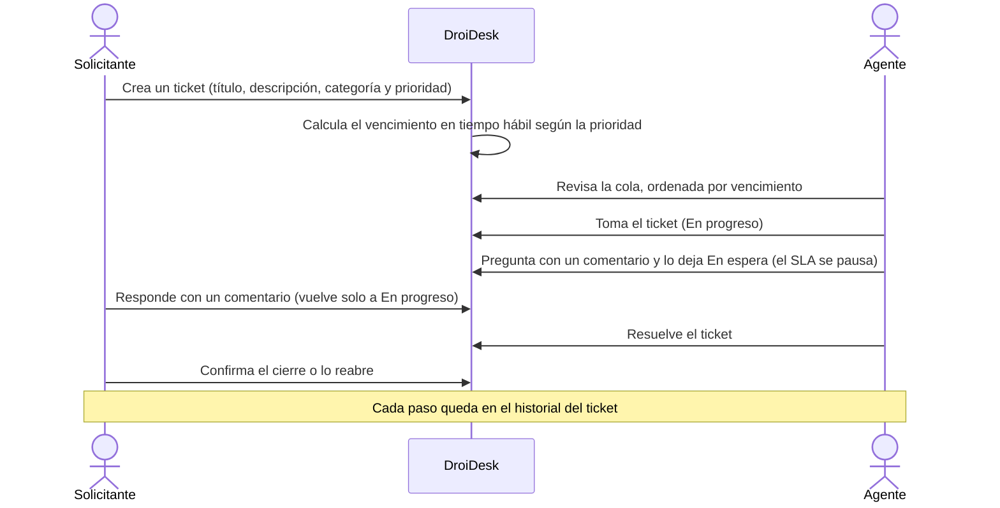
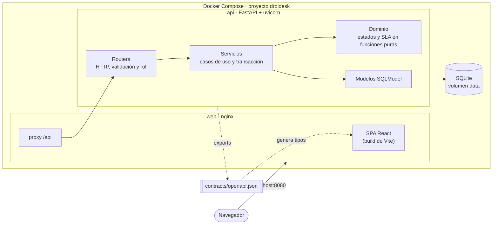

# DroiDesk

Sistema de tickets de soporte para una organización de ~800 personas: un solo lugar donde el solicitante pide ayuda y sigue su avance, y el equipo de soporte atiende una cola ordenada por urgencia. Cada cambio queda registrado con qué pasó, quién lo hizo y cuándo.

La interfaz se inspira en un droide astromecánico, el ayudante que diagnostica y repara sin hacer ruido: paneles blancos, acentos azules y luces de estado. Enunciado: [REQUIREMENTS.md](REQUIREMENTS.md).

## Inicio rápido

Requisitos: Docker con Compose v2 y bash (Linux, macOS o WSL).

```bash
./setup.sh
```

El script:
1. verifica Docker;
2. pregunta el puerto, la zona horaria, la jornada hábil y el modo de arranque;
3. genera el secreto de los tokens en `.env`, que no se versiona;
4. construye y levanta los contenedores, y espera a que respondan;
5. muestra la URL y los usuarios de demo.

Con `./setup.sh --yes` usa los valores por defecto sin preguntar. Si `.env` ya existe, ofrece reutilizarlo.

| Modo | Qué carga | Para qué |
|---|---|---|
| **Demo** (por defecto) | Los usuarios de demo y 9 tickets de ejemplo en distintos estados, con comentarios, respuestas citadas e historial | Recorrer las funcionalidades apenas termina el setup |
| **Vacío** | Solo los usuarios de demo y los catálogos | Empezar de cero |

Cambiar de modo no borra datos: los tickets de ejemplo se cargan solo mientras no exista ningún ticket. Para empezar de cero, `docker compose down -v` borra la base y `./setup.sh` vuelve a preguntar.

Abre `http://localhost:8080`, o el puerto que elegiste. El ingreso es simulado: cualquier contraseña sirve, y el ícono **?** de la pantalla de ingreso lista los usuarios de demo.

| Usuario | Perfil |
|---|---|
| `ana.rojas`, `bruno.castillo`, `carla.mena`, `diego.fuentes` | Solicitante |
| `elena.vidal`, `felipe.araya`, `gabriela.soto` | Agente de soporte |

Para probar los dos perfiles a la vez, usa dos navegadores o una ventana privada.

```bash
docker compose down      # detiene DroiDesk y conserva los datos
docker compose down -v   # detiene DroiDesk y borra la base de datos
```

## Cómo funciona



- **Solicitante**: crea tickets, sigue los suyos, conversa con el agente, confirma la solución o reabre, y cancela lo que nadie tomó.
- **Agente**: ve la cola completa y sus asignados, toma tickets, ajusta la prioridad, conversa y mueve el estado.
- **SLA por prioridad**, en tiempo hábil de lunes a viernes: Crítica 4 horas, Alta 1 día, Media 3 días y Baja 5 días. Una luz muestra si el ticket está en plazo, por vencer, vencido o en pausa.
- **Listados** filtrables por prioridad y estado del SLA, y ordenables por vencimiento, prioridad o fecha.

La máquina de estados y el porqué de cada estado están en [DECISIONS.md](DECISIONS.md#máquina-de-estados-del-ticket).

## Arquitectura

Dos apps independientes, cada una con sus dependencias, tests, Dockerfile y CI. No se importan entre sí: se comunican solo por el contrato OpenAPI ([ADL-001](.design-logs/ADL-001-two-apps-openapi-contract.md)).



- **Mismo origen**: nginx sirve la SPA y reenvía `/api` a la API, así que no hace falta CORS y la API no publica puertos ([ADL-006](.design-logs/ADL-006-docker-compose-same-origin.md)).
- **Contrato**: la API exporta `contracts/openapi.json` y la web genera sus tipos desde ese archivo. CI falla si alguno de los dos queda desactualizado.
- **Arranque**: la API aplica las migraciones de Alembic y carga los usuarios de demo, los catálogos y, en el modo Demo, los tickets de ejemplo.

| App | Stack |
|---|---|
| [`apps/api`](apps/api) | Python 3.14, FastAPI, SQLModel, Alembic, SQLite, uv, ruff, mypy, pytest |
| [`apps/web`](apps/web) | React 19, Vite, TypeScript, React Router, TanStack Query, openapi-fetch, CSS Modules, Biome, Vitest |
| [`e2e`](e2e) | Playwright Test: smoke del recorrido principal contra el stack Docker |

El detalle está en [`specs/tech-stack.md`](specs/tech-stack.md).

## Estructura del repositorio

```text
apps/api/        API: src/droidesk_api, migraciones, tests y Dockerfile
apps/web/        Web: src/, tests, nginx.conf y Dockerfile
contracts/       Contrato OpenAPI compartido
e2e/             Smoke end-to-end
specs/           Spec-Driven Development: constitución y feature 001
.design-logs/    Decisiones de arquitectura (ADL)
.claude/         Skills, agente deckard y hook de DEV-LOG
setup.sh         Único comando de arranque
```

## Desarrollo

Cada app se trabaja por separado. En desarrollo, el proxy de Vite reemplaza a nginx.

```bash
# API, en http://localhost:8000
cd apps/api
uv sync
export DROIDESK_JWT_SECRET=$(openssl rand -hex 32) DROIDESK_DATABASE_URL=sqlite:///./droidesk.db
uv run alembic upgrade head && uv run python -m droidesk_api.seed
uv run uvicorn --factory droidesk_api.main:create_app --reload

# Web, en http://localhost:5173
cd apps/web
npm ci
npm run dev
```

Si cambias un endpoint, regenera el contrato y los tipos en el mismo commit:

```bash
(cd apps/api && uv run python scripts/export_openapi.py)
(cd apps/web && npm run gen:api)
```

## Calidad

| Alcance | Comandos | Gate |
|---|---|---|
| API | `uv run ruff check . && uv run ruff format --check . && uv run mypy && uv run pytest` | 80 % de cobertura total y 90 % en el flujo crítico |
| Web | `npm run lint:ci && npm run typecheck && npm run test:coverage && npm run build` | 80 % de cobertura total y 90 % en `src/features/` |
| Smoke | `cd e2e && npm ci && npx playwright install chromium && DROIDESK_BASE_URL=http://localhost:8080 npm test` | El recorrido crear → tomar → en espera → comentar → resolver → cerrar |

El flujo crítico es el ciclo de vida del ticket, con sus reglas de SLA y la autorización por rol. Qué se probó, qué no y por qué está en la [estrategia de calidad](DECISIONS.md#estrategia-de-calidad). GitHub Actions corre un workflow por app y otro para el smoke, que levanta el stack con `./setup.sh --yes`.

## Documentación

| Documento | Contenido |
|---|---|
| [DECISIONS.md](DECISIONS.md) | Modelo de datos, máquina de estados, alcance opcional, estrategia de calidad y deuda técnica |
| [SCALABILITY.md](SCALABILITY.md) | Tres estrategias para 50.000 tickets al mes y 5 áreas, con PostgreSQL, y la elegida |
| [AI-USAGE.md](AI-USAGE.md) | Herramientas de IA, estructura del contexto, qué se delegó, dónde intervino el humano y qué se rechazó |
| [DEV-LOG.md](DEV-LOG.md) | Registro de cada interacción con el agente, escrito por un hook |
| [`specs/`](specs/) | Misión, stack, roadmap, y spec, plan, tareas y contrato de la feature 001 |
| [`.design-logs/`](.design-logs/) | Decisiones de arquitectura (ADL) con su contexto y alternativas |
| [Quickstart](specs/001-ticketing-mvp/quickstart.md) | Escenarios para validar la feature a mano |
