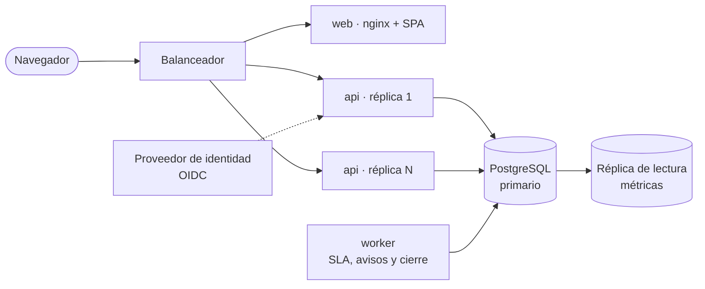
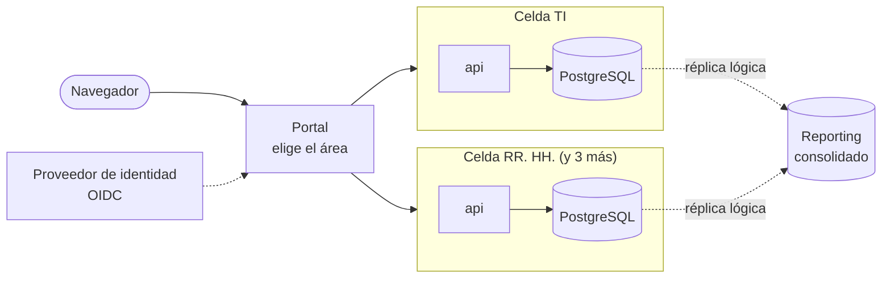
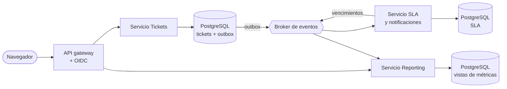

# SCALABILITY · DroiDesk

Tres estrategias para llevar DroiDesk de un MVP para unas 800 personas a **50.000 tickets al mes y 5 áreas de soporte**. Todas usan PostgreSQL. La estrategia que elija el usuario completa la sección "qué romperías o rediseñarías" de [DECISIONS.md](DECISIONS.md) y se registra en un ADL nuevo.

## 1. Qué significa la meta

| Magnitud | Estimación | Fuente |
|---|---|---|
| Tickets | 50.000 al mes: unos 2.300 por día hábil y unos 250 por hora en la jornada | Enunciado, con 22 días hábiles de 9 horas |
| Historial | De 6 a 8 eventos por ticket: unos 400.000 al mes y 5 millones al año | Recorrido típico del smoke: 8 eventos |
| Comentarios | Unos 2 por ticket: 100.000 al mes | Supuesto |
| Escrituras | Unas 10 filas por ticket (el ticket, sus eventos y sus comentarios): menos de 1 por segundo en promedio en la jornada, y unas pocas por segundo en los picos | Cálculo sobre las filas anteriores |
| Agentes | De 50 a 100, repartidos en 5 áreas | Supuesto: de 10 a 20 por área |
| Solicitantes | Miles, con picos en la mañana | Supuesto |

El volumen es moderado para PostgreSQL: cabe en una sola instancia con holgura. **Lo que más cambia no es la carga: son las áreas.** Cada una tiene su propia cola, sus agentes, sus categorías y sus políticas de SLA, y quizás también su propio horario y sus feriados. Además se necesita mover tickets entre áreas y ver métricas por área.

## 2. Qué rompe el MVP y qué se conserva

Lo que se rompe o se rediseña, sea cual sea la estrategia:

| Pieza del MVP | Por qué no escala | Cambio |
|---|---|---|
| SQLite en un volumen | Un solo escritor a la vez; sin réplicas ni respaldo en caliente | PostgreSQL administrado, con respaldos y réplica de lectura ([ADL-003](.design-logs/ADL-003-sqlite-mvp-postgres-path.md)) |
| Migraciones al iniciar la API | Con varias réplicas, compiten entre ellas | Un paso de despliegue antes de liberar la versión nueva |
| Listados completos, filtrados en la web | 50.000 tickets al mes no caben en una respuesta | Paginación por cursor; filtros y orden como parámetros de la API (FR-024a) |
| Una cola global | Las 5 áreas no comparten agentes ni prioridades | Entidad `Area`, con agentes, categorías y colas por área |
| SLA, jornada y zona horaria globales | Cada área puede tener sus plazos y su horario | Políticas, calendario y feriados por área |
| Ingreso simulado | Cualquiera entra como cualquiera | SSO con OIDC contra el proveedor de identidad de la organización; los perfiles y las áreas vienen de los grupos |
| Sin reasignación | Un ticket mal clasificado queda atrapado en un área | Transferir el ticket entre áreas y reasignarlo entre agentes, con evento en el historial |
| Sin trabajos en segundo plano | Nadie avisa de lo que está por vencer ni cierra lo resuelto | Un worker para avisos de SLA, notificaciones y cierre automático |
| Sin métricas | "¿Cuánto demoran?" exige consultas agregadas | Métricas de cumplimiento del SLA por área y por agente, sin cargar la base transaccional |

Lo que se conserva:
- **La máquina de estados y el calendario hábil**: son funciones puras, sin dependencias de FastAPI ni de la base ([ADL-008](.design-logs/ADL-008-ticket-lifecycle-six-states.md), [ADL-009](.design-logs/ADL-009-sla-business-time.md)).
- **El historial append-only y las transiciones condicionales**: funcionan igual en PostgreSQL, y la carrera ya está resuelta sin locks.
- **El contrato OpenAPI** como frontera entre la web y la API, que crece sin romper a quien lo consume.
- **Las dos apps independientes**, Docker y la pirámide de tests con sus gates.

## 3. Estrategias

### A. Monolito modular sobre PostgreSQL

La misma API, con el área como dimensión de primera clase, sobre PostgreSQL y con varias réplicas sin estado. Un worker comparte el código de la API y toma sus trabajos de una cola en la misma base.

- **Datos**: una base con `area_id` en tickets, categorías, políticas y agentes. La cola usa el índice `(area_id, status, sla_due_at)` y los listados se paginan por cursor.
- **Trabajos**: una cola en PostgreSQL con `SELECT … FOR UPDATE SKIP LOCKED`, sin un broker aparte. Se encarga de los avisos de vencimiento, las notificaciones por correo y el cierre automático de los tickets resueltos.
- **Métricas**: vistas materializadas o consultas sobre la réplica de lectura.

| Pros | Contras |
|---|---|
| El cambio más chico: se reutiliza la mayor parte del código y de los tests | Un solo despliegue para las 5 áreas: un error afecta a todas |
| Un solo esquema y una sola base: las transferencias entre áreas son una transacción local | La base es un recurso compartido: una consulta pesada de métricas puede afectar a la cola si no se separa a la réplica |
| Operación simple para un equipo chico: una base, una imagen de API y un worker | Escala vertical en la base: alcanza con holgura para esta meta, pero no para 10 veces más sin partir tablas |
| El costo de infraestructura más bajo | El aislamiento entre áreas depende del código (filtros por `area_id`) |

| Riesgo | Mitigación |
|---|---|
| Un agente ve o mueve tickets de otra área | Autorización por área en el servicio, como hoy por rol, con tests por endpoint; Row Level Security de PostgreSQL como segunda línea |
| Las métricas lentifican la cola | Consultas agregadas solo contra la réplica de lectura o contra vistas materializadas |
| `ticket_events` crece sin límite (5 millones de filas al año) | Índice por `(ticket_id, occurred_at)`; particionar por mes cuando pase de unas decenas de millones |
| La cola en la base se vuelve un cuello de botella | El volumen de trabajos es bajo (unos miles al día); si crece, el worker pasa a un broker sin tocar los casos de uso |

### B. Celdas por área

Una instancia completa de DroiDesk por área (web, API y base propias), con dos servicios compartidos: la identidad y un portal que lleva al solicitante a la celda que corresponde. Un servicio de reporting consolida las métricas de las 5 celdas.

- **Datos**: cada celda tiene su base con el esquema actual, sin `area_id`. Sus políticas, su horario y sus feriados son configuración propia de la celda.
- **Transferir entre áreas**: cerrar el ticket en la celda de origen con un evento "transferido" y crearlo en la de destino con una referencia al original. Esa coordinación entre celdas pasa por una API.
- **Métricas**: la replicación lógica de PostgreSQL lleva los datos de cada celda a una base de reporting.

| Pros | Contras |
|---|---|
| Aislamiento real: una falla, un despliegue o una consulta pesada afecta solo a su área | Se operan 5 bases y 5 despliegues, más el portal y el reporting: unas 5 veces la infraestructura |
| Cada área evoluciona a su ritmo y con su configuración, sin filtros por `area_id` en el código | Transferir un ticket entre áreas deja de ser una transacción: el historial queda partido entre dos celdas |
| El código actual casi no cambia dentro de cada celda | El solicitante debe saber a qué área escribir, o el portal debe adivinarlo |
| Crecer a 10 o 20 áreas es agregar celdas | Las métricas globales dependen de un pipeline de replicación que hay que mantener |

| Riesgo | Mitigación |
|---|---|
| Las celdas quedan con versiones distintas del esquema o del código | Un solo artefacto versionado, desplegado a todas las celdas por el mismo pipeline, con migraciones automáticas por celda |
| Un ticket transferido pierde su trazabilidad | Evento de transferencia en ambas celdas, con el id de origen, y una vista de historial unificada en el reporting |
| El costo de operar 5 entornos supera al equipo | Infraestructura como código e imágenes idénticas; evaluar celdas en una misma instancia de PostgreSQL con bases separadas |
| El solicitante elige mal el área | El portal sugiere el área por categoría, y la transferencia corrige lo que quede mal clasificado |

### C. Servicios por contexto con eventos

La API se divide por contexto de negocio: **Tickets** (ciclo de vida, comentarios e historial), **SLA y notificaciones**, y **Reporting**. Se comunican con eventos que pasan por un broker. Tickets publica cada hecho con el patrón outbox, y los demás servicios mantienen sus propias vistas (CQRS).

- **Datos**: cada servicio es dueño de su base. Tickets guarda el estado y el historial; SLA guarda los vencimientos y las pausas; Reporting guarda las vistas agregadas por área y por agente.
- **Eventos**: `ticket.created`, `ticket.status_changed` y `comment.added`, entre otros, con entrega al menos una vez y consumidores idempotentes.
- **La cola del agente**: Tickets la arma con el vencimiento que le llega desde SLA, que es una consistencia eventual de segundos.

| Pros | Contras |
|---|---|
| Cada contexto escala, se despliega y falla por separado | La mayor complejidad: broker, outbox, idempotencia, versionado de eventos y trazas distribuidas |
| Reporting y notificaciones no cargan la base transaccional | El SLA, hoy una función pura en la misma transacción, pasa a ser eventual: la cola puede mostrar un vencimiento desactualizado por unos segundos |
| Agregar consumidores es fácil: notificaciones, integraciones, IA de categorización | Los tests de integración y el smoke se vuelven más lentos y frágiles |
| Prepara a la organización para volúmenes de 10 a 100 veces la meta | Sobredimensiona la meta: 50.000 tickets al mes no lo exigen |

| Riesgo | Mitigación |
|---|---|
| Se pierden eventos o se duplican | Outbox en la misma transacción que el cambio, entrega al menos una vez y consumidores idempotentes por id de evento |
| El orden de los eventos de un ticket se altera | Partición del broker por `ticket_id` y número de secuencia por ticket |
| Un cambio en un evento rompe a sus consumidores | Esquemas de eventos versionados en el repo, como hoy el OpenAPI, con tests de contrato |
| El equipo no puede operar la plataforma | Broker administrado; empezar solo con Reporting como servicio aparte, y dividir más solo si duele |

## 4. Comparación

| Criterio | A · Monolito modular | B · Celdas por área | C · Servicios con eventos |
|---|---|---|---|
| Cumple 50.000 tickets al mes | Sí, con holgura | Sí | Sí, con mucha holgura |
| Esfuerzo de migración desde el MVP | Bajo | Medio | Alto |
| Aislamiento entre áreas | Lógico (código y RLS) | Total | Por contexto, no por área |
| Transferir un ticket entre áreas | Transacción local | Coordinación entre celdas | Transacción local en Tickets |
| Métricas globales | Réplica de lectura | Pipeline de replicación | Servicio propio |
| Costo de infraestructura | 1 | Unas 5 veces | Unas 3 veces, más el broker |
| Operación con un equipo chico | Simple | Media | Exigente |
| Techo de crecimiento | Unas 10 veces la meta, partiendo tablas | Crece agregando celdas | El más alto |

## 5. Recomendación

**A · Monolito modular sobre PostgreSQL.** La meta es de volumen moderado. El problema real es modelar las áreas, y A lo resuelve con el menor cambio: el `area_id`, la autorización por área, la paginación y un worker.
- **Conserva** lo que el MVP ya probó: el dominio puro, las transiciones condicionales, el contrato y los tests.
- **Deja abiertos los otros caminos.** Si un área necesita aislamiento total, se puede sacar a una celda (B). Si las métricas o las notificaciones crecen, Reporting se puede separar como primer servicio con un outbox (C), sin rehacer el núcleo.

Orden sugerido para A:
1. PostgreSQL y migraciones como paso de despliegue.
2. SSO con OIDC, con perfiles y áreas que vienen de los grupos.
3. `Area` en el modelo, con autorización, colas, categorías y políticas por área.
4. Paginación por cursor, con filtros y orden en la API.
5. Transferencia entre áreas y reasignación entre agentes.
6. Worker para avisos de SLA, notificaciones y cierre automático.
7. Calendario hábil por área, con feriados.
8. Métricas de cumplimiento del SLA por área sobre la réplica de lectura.

## 6. Destino de lo diferido en la misión

| Diferido | Destino con A | Con B | Con C |
|---|---|---|---|
| Autenticación real | SSO con OIDC en la API | OIDC compartido por el portal y las celdas | OIDC en el gateway |
| Varias áreas de soporte | `Area` en el modelo | Una celda por área | Dimensión `area_id` en Tickets y Reporting |
| Feriados en el calendario del SLA | Tabla de feriados por área, leída por el calendario puro | Configuración de cada celda | Dueño: el servicio SLA |
| Cierre automático de tickets resueltos | Trabajo del worker | Worker por celda | Consumidor de SLA y notificaciones |

## 7. Decisión

**El usuario eligió la estrategia A · Monolito modular sobre PostgreSQL**, después de pedir una explicación más detallada de ella ([ADL-011](.design-logs/ADL-011-scale-modular-monolith-postgres.md)). La sección de escalamiento de [DECISIONS.md](DECISIONS.md) resume qué se rompe, qué se rediseña y qué se conserva.

Detalles de A que se fijaron al decidir:
- **Tamaño de partida**: PostgreSQL de 2 a 4 vCPU con una réplica de lectura, 2 réplicas de la API (por disponibilidad, no por carga) y un worker con la misma imagen.
- **Migración aditiva desde el MVP**: se crea un área inicial (por ejemplo, TI) y se le asignan los tickets, las categorías y las políticas existentes. Un perfil administrador mantiene las áreas, las categorías, las políticas y los feriados.
- **Transferir y reasignar**: transferir devuelve el ticket a Abierto en la cola del área de destino; reasignar cambia el agente dentro del área. Ambas son actualizaciones condicionales con su evento, como tomar un ticket.
- **Worker sin broker**: los trabajos se encolan en la misma transacción que el cambio que los origina, para que un aviso no se pierda si la API cae justo después del commit.
