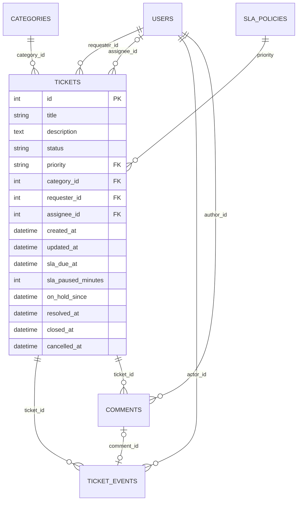

# Data Model: Ticketing MVP

**Feature**: `001-ticketing-mvp` · **Fuente**: [spec.md](spec.md) · **Decisiones**: [ADL-003](../../.design-logs/ADL-003-sqlite-mvp-postgres-path.md), [ADL-008](../../.design-logs/ADL-008-ticket-lifecycle-six-states.md), [ADL-009](../../.design-logs/ADL-009-sla-business-time.md)

Todas las fechas se guardan en UTC. Los códigos van en inglés; las etiquetas en español, en la interfaz.

## Enumeraciones

| Enum | Códigos | Etiquetas |
|---|---|---|
| `Role` | `requester`, `agent` | Solicitante, Agente |
| `TicketStatus` | `open`, `in_progress`, `on_hold`, `resolved`, `closed`, `cancelled` | Abierto, En progreso, En espera, Resuelto, Cerrado, Cancelado |
| `Priority` | `critical`, `high`, `medium`, `low` | Crítica, Alta, Media, Baja |
| `TargetUnit` | `hours`, `days` | horas hábiles, días hábiles |
| `EventKind` | `created`, `assigned`, `status_changed`, `priority_changed`, `commented` | — |
| `SlaState` *(derivado, no se guarda)* | `on_track`, `at_risk`, `breached`, `paused`, `met`, `missed` | En plazo, Por vencer, Vencido, En pausa, Cumplido, Incumplido |
| `TicketAction` *(derivado)* | `take`, `cancel`, `hold`, `resume`, `resolve`, `close`, `reopen`, `comment`, `change_priority` | Tomar, Cancelar, Dejar en espera, Retomar, Resolver, Confirmar cierre, Reabrir, Comentar, Cambiar prioridad |

`resolved` no es un estado final: el solicitante puede cerrarlo o reabrirlo. Los estados finales son `closed` y `cancelled`.

## Tablas

### `users`

| Campo | Tipo | Reglas |
|---|---|---|
| `id` | entero, PK | |
| `username` | texto (50) | obligatorio, único; en minúsculas, entre `a-z`, `0-9`, `.`, `_` y `-` |
| `name` | texto (100) | obligatorio |
| `email` | texto (254) | obligatorio, único |
| `role` | `Role` | obligatorio |

### `categories`

| Campo | Tipo | Reglas |
|---|---|---|
| `id` | entero, PK | |
| `name` | texto (60) | obligatorio, único |

### `sla_policies`

| Campo | Tipo | Reglas |
|---|---|---|
| `priority` | `Priority`, PK | |
| `rank` | entero | 1 = la más urgente; ordena las opciones en la interfaz |
| `label` | texto (20) | "Crítica", "Alta"... |
| `description` | texto (200) | guía para que el solicitante elija el nivel (FR-019) |
| `target_amount` | entero | > 0 |
| `target_unit` | `TargetUnit` | `hours` o `days` |

El plazo se guarda en la unidad en que lo define el negocio ("1 día hábil", no "540 minutos"): si cambia la jornada, un día hábil sigue siendo una jornada.

### `tickets`

| Campo | Tipo | Reglas |
|---|---|---|
| `id` | entero, PK | |
| `title` | texto (120) | obligatorio; se recortan espacios y no puede quedar vacío |
| `description` | texto (5.000) | obligatorio; misma regla |
| `status` | `TicketStatus` | por defecto `open` |
| `priority` | `Priority`, FK a `sla_policies` | por defecto `medium` |
| `category_id` | FK a `categories` | obligatorio |
| `requester_id` | FK a `users` | obligatorio; un usuario `requester` |
| `assignee_id` | FK a `users`, opcional | un usuario `agent`; se fija al tomar el ticket |
| `created_at` / `updated_at` | fecha y hora UTC | |
| `sla_due_at` | fecha y hora UTC | vencimiento vigente (ADL-009) |
| `sla_paused_minutes` | entero ≥ 0 | minutos hábiles acumulados en espera que cuentan para el SLA |
| `on_hold_since` | fecha y hora UTC, opcional | inicio de la espera en curso |
| `resolved_at` / `closed_at` / `cancelled_at` | fecha y hora UTC, opcional | momentos del ciclo; `resolved_at` vuelve a vacío al reabrir |

Índices: `(status, sla_due_at)` para la cola, `(requester_id, created_at)` para "Mis tickets" y `(assignee_id)` para "Asignados a mí".

### `ticket_events` (append-only)

| Campo | Tipo | Reglas |
|---|---|---|
| `id` | entero, PK | |
| `ticket_id` | FK a `tickets` | obligatorio |
| `actor_id` | FK a `users` | obligatorio: quién provocó el hecho |
| `kind` | `EventKind` | obligatorio |
| `from_value` / `to_value` | texto (100, el largo de `User.name`), opcional | estado o prioridad anterior y nueva; agente asignado en `assigned` |
| `comment_id` | FK a `comments`, opcional | solo en `commented` |
| `created_at` | fecha y hora UTC | |

Nunca se actualiza ni se borra. Índice: `(ticket_id, created_at)`.

### `comments`

| Campo | Tipo | Reglas |
|---|---|---|
| `id` | entero, PK | |
| `ticket_id` | FK a `tickets` | obligatorio |
| `author_id` | FK a `users` | obligatorio |
| `body` | texto (2.000) | obligatorio; se recortan espacios y no puede quedar vacío |
| `reply_to_id` | FK a `comments`, opcional | comentario citado como respuesta; del mismo ticket (FR-017b) |
| `created_at` | fecha y hora UTC | |

Sin edición ni borrado, igual que el historial. Índice: `(ticket_id, created_at)`.

## Acciones y sus efectos

Cada acción cambia el ticket y escribe sus eventos **en la misma transacción**. La tabla de transiciones vive en el dominio (ADL-008).

| Acción | Desde → Hacia | Quién | Efectos en `tickets` | Eventos |
|---|---|---|---|---|
| crear | — → `open` | solicitante | todos los campos iniciales; `sla_due_at` calculado | `created` |
| `take` | `open` → `in_progress` | agente | `assignee_id` = agente, mediante un UPDATE condicional atómico | `assigned`, `status_changed` |
| `cancel` | `open` → `cancelled` | solicitante dueño | `cancelled_at`, también con un UPDATE condicional | `status_changed` |
| `hold` | `in_progress` → `on_hold` | agente asignado | `on_hold_since` = ahora | `status_changed` |
| `resume` | `on_hold` → `in_progress` | agente asignado, o el sistema cuando comenta el solicitante | suma la espera a `sla_paused_minutes` si empezó antes del vencimiento; recalcula `sla_due_at`; `on_hold_since` = vacío | `status_changed` |
| `resolve` | `in_progress` → `resolved` | agente asignado | `resolved_at` = ahora | `status_changed` |
| `close` | `resolved` → `closed` | solicitante dueño | `closed_at` = ahora | `status_changed` |
| `reopen` | `resolved` → `in_progress` | solicitante dueño | `resolved_at` = vacío; el vencimiento no cambia | `status_changed` |
| `change_priority` | cualquier estado no resuelto ni final | agente | `priority`; recalcula `sla_due_at` | `priority_changed` |
| `comment` | cualquier estado no final | solicitante dueño o cualquier agente | si está `on_hold` y comenta el solicitante, aplica `resume` | `commented` (+ `status_changed` si hubo `resume`) |

Las acciones permitidas para quien consulta (`allowed_actions`) salen de esta tabla, del rol y de la relación con el ticket (dueño o asignado).

## SLA en tiempo hábil (ADL-009)

- **Calendario**: lunes a viernes, dentro de `DROIDESK_BUSINESS_HOURS` (por defecto `09:00-18:00`), en `DROIDESK_TIMEZONE` (por defecto `America/Santiago`). Los feriados no se consideran.
- **Plazo en minutos**: `target_amount × 60` si la unidad es `hours`, o `target_amount × minutos de la jornada` si es `days`.
- **Vencimiento**: `sla_due_at = sumar_minutos_hábiles(created_at, plazo + sla_paused_minutes)`. Se recalcula al crear, al cambiar la prioridad y al retomar.
- **Estado del SLA**, derivado al leer con un reloj inyectable:

| Situación | Estado |
|---|---|
| `cancelled` | ninguno |
| `resolved` o `closed` | `met` si `resolved_at ≤ sla_due_at`; si no, `missed` |
| `on_hold` y la espera empezó antes del vencimiento | `paused` |
| ahora ≥ `sla_due_at` (incluye una espera que empezó ya vencido) | `breached` |
| quedan menos minutos hábiles que el 25 % del plazo | `at_risk` |
| en otro caso | `on_track` |

- **Orden de la cola** (FR-024): primero los tickets con el reloj corriendo, por `sla_due_at` ascendente; después los `on_hold`; a igual criterio, por `created_at`.

## Datos de demo (seed)

| Datos | Contenido |
|---|---|
| Usuarios | 4 solicitantes y 3 agentes, con nombres genéricos y correo `@droidesk.local` |
| Categorías | Hardware, Software, Accesos y cuentas, Red y conectividad, Otro |
| Políticas de SLA | Crítica 4 h, Alta 1 día, Media 3 días y Baja 5 días hábiles, cada una con su descripción guía |
| Tickets de ejemplo | 9 tickets en los seis estados y las cuatro prioridades, con comentarios, una respuesta citada y un ajuste de prioridad. Se reproducen con `TicketService` y quedan fechados en relación con el momento de la carga, así que se ven los estados del SLA en plazo, vencido, en pausa y cumplido |

Los usuarios, las categorías y las políticas se cargan siempre que la base está vacía. Los tickets de ejemplo se cargan solo en el modo de arranque Demo (`DROIDESK_MODE=demo`, el valor por defecto) y si todavía no hay ningún ticket; el modo Vacío (`empty`) deja solo la base ([ADL-005](../../.design-logs/ADL-005-simulated-auth-signed-token.md)).
