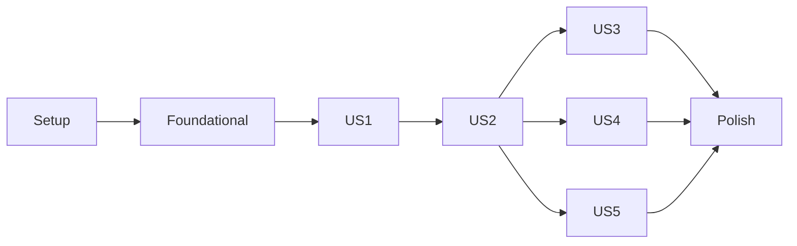

# Tasks: Ticketing MVP

**Feature**: `001-ticketing-mvp` · **Input**: [plan.md](plan.md), [spec.md](spec.md), [data-model.md](data-model.md), [contracts/rest-api.md](contracts/rest-api.md), [research.md](research.md) y [quickstart.md](quickstart.md)

**Formato**: `- [ ] T### [P?] [US?] Descripción con ruta exacta`. `[P]` marca las tareas paralelizables (archivos distintos y sin dependencias pendientes). Las rutas son relativas a la raíz del repo.

**Tests**: obligatorios. Los gates de cobertura de [ADL-007](../../.design-logs/ADL-007-pareto-coverage-gates.md) son 80 % total y 90 % en el flujo crítico. El dominio se escribe con TDD: primero el test, luego el código.

**Ejecución**: cada bloque lo implementa un subagente Sonnet 5.5 xHigh, con las reglas de [CLAUDE.md](../../CLAUDE.md) y las configuraciones de referencia de `research.md`. El bloque cierra con su checkpoint (lint sin warnings → tests y cobertura → deckard → ADL) y con la aprobación del usuario antes del commit.

---

## Phase 3 · Block 1: Setup

**Objetivo**: las dos apps creadas, con tooling, Docker y CI funcionando, sin funcionalidades.

- [x] T001 Crear `apps/api/pyproject.toml` con las versiones fijadas de research (API) y la configuración de pytest, coverage, ruff, mypy y Alembic; generar `apps/api/uv.lock` con uv 0.13.1.
- [x] T002 Crear `apps/api/src/droidesk_api/main.py` con la app y `GET /api/health`, y su test `apps/api/tests/api/test_health.py`.
- [x] T003 [P] Scaffold de `apps/web` con `npm create vite@9.2.1 apps/web -- --template react-ts --no-interactive`:
  - quitar Oxlint y los assets de ejemplo;
  - fijar en `apps/web/package.json` las versiones de research (Web), con `overrides` para openapi-typescript;
  - agregar `apps/web/biome.json` y TypeScript estricto en `apps/web/tsconfig.app.json`;
  - configurar el proxy y Vitest con los umbrales en `apps/web/vite.config.ts`;
  - crear `apps/web/src/test/setup.ts` y un smoke test en `apps/web/src/app/App.test.tsx`.
- [x] T004 [P] Crear `apps/api/Dockerfile` (multi-stage con uv y usuario no root), `apps/api/.dockerignore` y `apps/api/docker-entrypoint.sh` (corre `alembic upgrade head` y después `exec uvicorn`).
- [x] T005 [P] Crear `apps/web/Dockerfile` (`node:24-alpine` → `nginx:1.30-alpine`), `apps/web/.dockerignore` y `apps/web/nginx.conf`, con el proxy de `/api` y los headers de seguridad.
- [x] T006 Crear `docker-compose.yml`:
  - servicios `api` y `web`;
  - volumen nombrado para SQLite;
  - `web` depende de `api` con `condition: service_healthy`;
  - variables leídas desde `.env`.
- [x] T007 [P] Crear `.github/workflows/api.yml`: filtro de rutas `apps/api/**` y `contracts/**`; pasos ruff, mypy, pytest con los dos gates, `alembic check` y el diff del contrato; acciones fijadas por SHA.
- [x] T008 [P] Crear `.github/workflows/web.yml`: filtro de rutas `apps/web/**` y `contracts/**`; pasos: diff de `schema.d.ts`, `biome ci`, `tsc -b`, coverage con umbrales y build.
- [x] T009 Contrato inicial:
  - crear `apps/api/scripts/export_openapi.py` y generar `contracts/openapi.json`;
  - agregar el script `gen:api` en `apps/web/package.json`;
  - generar `apps/web/src/api/schema.d.ts`.

**Checkpoint**: las dos apps pasan lint, tipos y tests en local y en CI; `docker compose up` deja `/api/health` en verde, también a través de nginx.

---

## Phase 3 · Block 2: Foundational

**Objetivo**: el esquema completo, el núcleo de dominio, el ingreso simulado y el esqueleto de la web por rol. Bloquea todas las user stories.

### API
- [x] T010 [P] Crear `apps/api/src/droidesk_api/core/config.py`:
  - settings con prefijo `DROIDESK_` (URL de la base, secreto de al menos 32 bytes, datos de demo, zona horaria y jornada);
  - validar la jornada (cierre posterior a la apertura) al iniciar;
  - crear también `apps/api/src/droidesk_api/core/clock.py`, con un reloj inyectable.
- [x] T011 [P] Crear `apps/api/src/droidesk_api/core/db.py`:
  - `build_engine`, con los pragmas FK y WAL solo en este engine;
  - naming convention en `SQLModel.metadata`;
  - la dependencia `SessionDep`.
- [x] T012 [P] Crear `apps/api/src/droidesk_api/core/errors.py`:
  - la jerarquía `DomainError` (401, 403, 404, `already_taken` 409, `action_not_allowed` 409);
  - el esquema `ErrorBody`;
  - el handler `{code, message}`.
- [x] T013 Crear los modelos y enums (`StrEnum` con valores en minúscula), según data-model.md:
  - `User` y `Role` en `apps/api/src/droidesk_api/identity/models.py`;
  - `Ticket`, `Category`, `TicketStatus` y `Priority` en `apps/api/src/droidesk_api/tickets/models.py`;
  - `SlaPolicy` y `TargetUnit` en `apps/api/src/droidesk_api/sla/models.py`;
  - `TicketEvent` y `EventKind` en `apps/api/src/droidesk_api/audit/models.py`;
  - el agregador `apps/api/src/droidesk_api/models.py`.
  - *Nota de implementación*: los enums quedaron en `enums.py` puros de cada módulo, no en `models.py`, para que el dominio no importe SQLModel ([ADL-002](../../.design-logs/ADL-002-fastapi-sqlmodel-backend.md), extensión de la Fase 3).
- [x] T014 Configurar Alembic en `apps/api/migrations/`:
  - `env.py`, con la URL desde la configuración, sin pragmas FK y con `render_as_batch=True`;
  - `script.py.mako`, con `import sqlmodel.sql.sqltypes`;
  - crear `apps/api/migrations/versions/0001_initial.py` (users, categories, sla_policies, tickets y ticket_events).
- [x] T015 [P] Ciclo de vida en TDD:
  - primero `apps/api/tests/unit/test_lifecycle.py`, que cubre cada fila de la tabla de ADL-008, las transiciones inválidas, el rol, la relación (dueño o asignado) y `allowed_actions`;
  - luego `apps/api/src/droidesk_api/tickets/lifecycle.py`, como tabla declarativa y funciones puras.
- [x] T016 [P] Calendario hábil en TDD:
  - primero `apps/api/tests/unit/test_calendar.py`, con todos los bordes de ADL-009 y del quickstart (incluidos los cambios de horario del 2026-04-04 y el 2026-09-05, y la propiedad inversa);
  - luego `apps/api/src/droidesk_api/sla/calendar.py`, con `BusinessCalendar`, `add_business_minutes` y `business_minutes_between`.
- [x] T017 [P] Estado del SLA en TDD:
  - primero `apps/api/tests/unit/test_sla_status.py`;
  - luego `apps/api/src/droidesk_api/sla/status.py`, con el plazo en minutos según la unidad, el vencimiento con pausas, el `SlaState` derivado con el reloj y la clave de orden de la cola.
- [x] T018 [P] Crear `apps/api/src/droidesk_api/core/security.py` (emitir y leer el JWT HS256 con `sub`, `iat` y `exp`) y su test `apps/api/tests/unit/test_security.py`.
- [x] T019 Crear la autorización y el ingreso:
  - `apps/api/src/droidesk_api/identity/authorization.py`: usuario actual cargado desde la base, guardas de rol y `ensure_can_view`;
  - `apps/api/src/droidesk_api/identity/router.py`: `POST /api/v1/auth/login` y `GET /api/v1/me`;
  - *Revisión del usuario*: el login recibe usuario y contraseña, acepta cualquier contraseña de un usuario precreado y nunca crea usuarios. `GET /api/v1/auth/users` devuelve los usuarios de demo para la ayuda ([ADL-005](../../.design-logs/ADL-005-simulated-auth-signed-token.md));
  - test `apps/api/tests/api/test_auth.py`.
- [x] T020 [P] Crear `apps/api/src/droidesk_api/audit/recorder.py` (registrar y listar eventos de un ticket) y su test `apps/api/tests/unit/test_recorder.py`.
- [x] T021 Crear los catálogos:
  - `GET /api/v1/sla-policies` en `apps/api/src/droidesk_api/sla/router.py`;
  - `GET /api/v1/categories` en `apps/api/src/droidesk_api/tickets/router.py`;
  - test `apps/api/tests/api/test_catalogs.py`.
- [x] T022 Crear `apps/api/src/droidesk_api/seed.py`, que carga usuarios, categorías y políticas de demo si `DROIDESK_SEED_DEMO_DATA=true` (en la Fase 9 pasó a `DROIDESK_MODE`, ver T059) y la base está vacía, e invocarlo desde `apps/api/docker-entrypoint.sh`.
- [x] T023 Conectar en `apps/api/src/droidesk_api/main.py` los routers, el handler de errores y el lifespan; regenerar `contracts/openapi.json`.

### Web
- [x] T024 [P] Crear el design system del droide según los tokens de tech-stack.md, en `apps/web/src/ui/`:
  - `tokens.css`;
  - `Button.tsx`, `Panel.tsx` y `EmptyState.tsx`;
  - `Light.tsx`, una luz que siempre va acompañada de texto;
  - `DroidLogo.tsx`, en SVG propio.
- [x] T025 [P] Crear `apps/web/src/api/client.ts` (openapi-fetch con `baseUrl` = origen, `fetch` envuelto, middleware Bearer, cierre de sesión ante un 401, y `$api` de openapi-react-query) y regenerar `apps/web/src/api/schema.d.ts`.
- [x] T026 Crear el ingreso:
  - `apps/web/src/features/auth/session.ts`, sobre `sessionStorage`;
  - `apps/web/src/features/auth/LoginPage.tsx`, con el formulario de usuario y contraseña y la ayuda "?" con los usuarios de demo por perfil (revisión del usuario; antes, una lista de usuarios para elegir);
  - sus tests `session.test.ts` y `LoginPage.test.tsx`.
- [x] T027 Crear el ruteo y el layout:
  - `apps/web/src/app/guards.ts` (middleware `requireSession` y `requireRole`) y `apps/web/src/app/router.tsx` (`/login`, `/requester` y `/agent`);
  - `apps/web/src/app/providers.tsx` y `apps/web/src/app/AppLayout.tsx` (encabezado con logo, usuario y salir, que también llama a `queryClient.clear()`);
  - el test `guards.test.tsx`, con `createMemoryRouter`.
- [x] T028 [P] Crear las páginas vacías por rol, `apps/web/src/features/requester/MyTicketsPage.tsx` y `apps/web/src/features/agent/QueuePage.tsx`, con su estado vacío; y las etiquetas en español de estados, prioridades, acciones y SLA en `apps/web/src/features/tickets/labels.ts`.

**Checkpoint**: se ingresa como solicitante o como agente y cada uno ve su vista vacía, con escenario 3 del quickstart incluido; dominio y autorización ≥ 90 %, total ≥ 80 % en ambas apps.

---

## Phase 4 · US1: Crear y seguir mis tickets (P1)

**Objetivo**: el solicitante crea, lista, ve y cancela sus tickets.
**Test independiente**: escenarios 1, 2, 4 y 12 del quickstart.

- [x] T029 [US1] Crear `apps/api/src/droidesk_api/tickets/schemas.py`: `TicketCreate`, `TicketSummary`, `TicketDetail`, `Sla`, `UserRef` y `TransitionRequest`, con largos validados después de recortar espacios.
- [x] T030 [US1] Crear `apps/api/src/droidesk_api/tickets/service.py` con:
  - `create_ticket`: prioridad por defecto `medium`, vencimiento con `sla/status.py` y evento `created`, en una transacción;
  - `list_my_tickets` y `get_ticket_for` (un ticket ajeno responde 404);
  - `apply_transition` genérico sobre `lifecycle.py`, con `cancel` como actualización condicional.
  - *Implementado*: el servicio es la clase `TicketService(session, clock, calendar)`, con la presentación en `tickets/presenter.py`. Todas las transiciones son condicionales, no solo `cancel`. Una categoría inexistente responde 422 con `loc` en `category_id`. `take` y `resume` responden 409 hasta US2 (T037).
- [x] T031 [US1] Agregar a `apps/api/src/droidesk_api/tickets/router.py`:
  - `POST /api/v1/tickets`, `GET /api/v1/tickets` (`view=mine`) y `GET /api/v1/tickets/{id}`;
  - `POST /api/v1/tickets/{id}/transitions`;
  - las respuestas 4xx declaradas para el OpenAPI.
- [x] T032 [US1] Crear `apps/api/tests/api/test_us1_requester_tickets.py`:
  - crear con datos válidos, con campos vacíos y con los bordes 120/121 y 5.000/5.001;
  - solo los propios en el listado; un ticket ajeno responde 404;
  - un agente no puede crear;
  - cancelar un ticket abierto, y cancelar uno no abierto responde 409.
- [x] T033 [US1] Regenerar `contracts/openapi.json` y `apps/web/src/api/schema.d.ts`.
- [x] T034 [P] [US1] Crear `apps/web/src/features/requester/NewTicketForm.tsx` (validación en español antes de enviar) y su test `NewTicketForm.test.tsx`.
- [x] T035 [P] [US1] Completar `apps/web/src/features/requester/MyTicketsPage.tsx` (estado con luz, "sin asignar", orden por fecha) y su test `MyTicketsPage.test.tsx`.
- [x] T036 [US1] Crear el detalle y las acciones:
  - `apps/web/src/features/tickets/TicketDetailPage.tsx`;
  - `apps/web/src/features/tickets/TicketActions.tsx`, con botones que salen de `allowed_actions` y confirmación al cancelar;
  - sus tests.

**Checkpoint**: escenarios 1, 2, 4 y 12 en verde; gates de cobertura.

---

## Phase 5 · US2: Cola del agente: tomar y cambiar estado (P1)

**Objetivo**: el agente ve la cola, toma tickets y los mueve; el solicitante cierra o reabre.
**Test independiente**: escenarios 6, 7, 10, 11 y 14 del quickstart.

- [x] T037 [US2] Extender `apps/api/src/droidesk_api/tickets/service.py`:
  - `list_queue`, con las vistas `queue` y `assigned` ordenadas con la clave de `sla/status.py`;
  - `take`, como actualización condicional, con los eventos `assigned` y `status_changed`;
  - en `hold`, `resume`, `resolve`, `close` y `reopen`, los efectos sobre `on_hold_since`, `sla_paused_minutes`, `resolved_at` y `closed_at`.
  - *Implementado*: el cálculo del SLA pasó al colaborador `tickets/ticket_sla.py`. `take` responde `already_taken` también si el ticket ya tenía otro asignado al leerlo (ADL-008). La cola incluye los Resueltos.
- [x] T038 [US2] Ampliar `GET /api/v1/tickets` en `apps/api/src/droidesk_api/tickets/router.py` con `view=queue|assigned` para agentes; un solicitante que pide esas vistas recibe 403.
- [x] T039 [US2] Crear `apps/api/tests/api/test_us2_agent_queue.py`:
  - la cola sin estados finales y la vista de asignados;
  - tomar, y una carrera de toma con hilos que deja exactamente un ganador;
  - tomar un ticket cancelado responde 409;
  - las transiciones inválidas responden 409, y un agente no asignado no puede mover el ticket;
  - `allowed_actions` según quién consulta.
- [x] T040 [US2] Regenerar `contracts/openapi.json` y `apps/web/src/api/schema.d.ts`.
- [x] T041 [P] [US2] Completar `apps/web/src/features/agent/QueuePage.tsx` (pestañas "Cola" y "Asignados a mí", estado con luz, solicitante, categoría y asignado) y su test `QueuePage.test.tsx`.
- [x] T042 [US2] Extender `apps/web/src/features/tickets/TicketActions.tsx`:
  - acciones de agente y de solicitante;
  - el mensaje de `already_taken`;
  - invalidar la cola y el detalle;
  - ampliar su test.

**Checkpoint**: escenarios 6, 7, 10, 11 y 14 en verde; gates de cobertura.

---

## Phase 6 · US3: Historial del ticket (P1)

**Objetivo**: los dos perfiles ven la línea de tiempo completa e inmutable de un ticket.
**Test independiente**: escenario 15 del quickstart.

- [x] T043 [US3] Incluir en `TicketDetail`, en `apps/api/src/droidesk_api/tickets/service.py`, el historial en orden cronológico con el autor, usando `apps/api/src/droidesk_api/audit/recorder.py`.
- [x] T044 [US3] Crear `apps/api/tests/api/test_us3_history.py`:
  - eventos y valores anterior y nuevo después de crear, tomar, dejar en espera y resolver;
  - el solicitante ve su historial y uno ajeno responde 404;
  - no existe ruta para editar ni borrar eventos.
- [x] T045 [US3] Crear `apps/web/src/features/tickets/Timeline.tsx` (etiquetas en español, autor, fecha y hora local) y su test `Timeline.test.tsx`.

**Checkpoint**: escenario 15 en verde; gates de cobertura.

---

## Phase 7 · US4: Comentarios (P2)

**Objetivo**: solicitante y agente conversan en el ticket; la respuesta del solicitante reactiva un ticket En espera.
**Test independiente**: escenarios 8 y 9 del quickstart.

- [x] T046 [US4] Agregar `Comment` en `apps/api/src/droidesk_api/tickets/models.py` y crear `apps/api/migrations/versions/0002_comments.py` (la tabla `comments` y `ticket_events.comment_id`, en modo batch).
  - *Implementado*: `Comment` vive en `tickets/models.py`, con el índice `(ticket_id, created_at)`.
- [x] T047 [US4] Agregar `add_comment` en `apps/api/src/droidesk_api/tickets/service.py`:
  - si el ticket está en un estado final, responde 409;
  - pueden comentar el solicitante dueño o cualquier agente;
  - registra el evento `commented`;
  - si comenta el solicitante sobre un ticket `on_hold`, aplica `resume` en la misma transacción.
- [x] T048 [US4] Agregar `POST /api/v1/tickets/{id}/comments` en `apps/api/src/droidesk_api/tickets/router.py` y los comentarios en el `TicketDetail`.
- [x] T049 [US4] Crear `apps/api/tests/api/test_us4_comments.py`:
  - comentan ambos perfiles;
  - bordes de largo (vacío, 2.000 y 2.001);
  - en tickets cerrados o cancelados responde 409; en un ticket ajeno, 404;
  - si comenta el solicitante en `on_hold`, el ticket pasa a `in_progress` y se registran los eventos;
  - si comenta el agente, el ticket sigue `on_hold`.
- [x] T050 [US4] Regenerar `contracts/openapi.json` y `apps/web/src/api/schema.d.ts`.
- [x] T051 [US4] Crear `apps/web/src/features/tickets/CommentBox.tsx` y la lista de comentarios en texto plano en `TicketDetailPage.tsx`; mostrar los eventos `commented` en `Timeline.tsx`; con sus tests.

  - *Revisión del usuario*: los listados muestran cuántos comentarios tiene cada ticket y el detalle el total (FR-017a, `TicketSummary.comment_count`). Un comentario puede citar a otro del mismo ticket como respuesta (FR-017b, `Comment.reply_to_id`, migración 0003).
  - *Corrección pedida por el usuario*: los ids enteros de la ruta y del cuerpo se acotan a `1..2^63-1` con un tipo compartido, así que un id fuera de rango responde 422 y no 500 por desbordamiento de SQLite.
**Checkpoint**: escenarios 8 y 9 en verde; gates de cobertura.

---

## Phase 8 · US5: SLA por prioridad (P2)

**Objetivo**: la prioridad se elige y se ajusta, el SLA se ve con luces y la cola se ordena por urgencia.
**Test independiente**: escenarios 5 y 13 del quickstart, más los bordes del SLA.

- [x] T052 [US5] Agregar `PATCH /api/v1/tickets/{id}` en `apps/api/src/droidesk_api/tickets/router.py` y `change_priority` en `apps/api/src/droidesk_api/tickets/service.py`:
  - recalcula el vencimiento desde la creación;
  - registra el evento `priority_changed`;
  - responde 409 si el ticket está resuelto o en un estado final.
  - *Implementado*: la regla vive en `lifecycle.authorize_priority_change`, la misma que alimenta `allowed_actions`. El cambio es idempotente y condicional sobre el estado, la prioridad y los minutos de espera (ADL-009).
- [x] T053 [US5] Crear `apps/api/tests/api/test_us5_sla.py`, con reloj controlado:
  - los ejemplos de creación del quickstart;
  - el cambio de prioridad;
  - la pausa y la reanudación;
  - una espera con el ticket ya vencido;
  - cumplido e incumplido;
  - el orden de la cola, con los `on_hold` al final.
- [x] T054 [US5] Regenerar `contracts/openapi.json` y `apps/web/src/api/schema.d.ts`.
- [x] T055 [P] [US5] Agregar en `apps/web/src/features/requester/NewTicketForm.tsx` el selector de prioridad, con las descripciones de `/sla-policies` y Media preseleccionada; ampliar su test.
- [x] T056 [P] [US5] Crear `apps/web/src/features/tickets/SlaLight.tsx` (estado del SLA con texto y vencimiento en hora local), usarlo en `MyTicketsPage.tsx`, `QueuePage.tsx` y `TicketDetailPage.tsx`, y crear su test `SlaLight.test.tsx`.
  - *Verificado*: T055 ya estaba cumplida desde la Fase 4. Para T056, `SlaLight` se extrajo de `StatusLight.tsx`; lo usan `TicketList` (Mis tickets, Cola y Asignados) y `TicketDetailPage`.
- [x] T057 [US5] Agregar el ajuste de prioridad del agente en `apps/web/src/features/tickets/TicketActions.tsx`, visible si `allowed_actions` incluye `change_priority`; ampliar su test.
  - *Revisión del usuario*: filtros por prioridad y estado del SLA y orden por vencimiento, prioridad o más recientes en los tres listados (FR-024a), aplicados en la web y guardados en la URL.

**Checkpoint**: escenarios 5 y 13 y los bordes del SLA en verde; gates de cobertura.

---

## Phase 9 · Polish: Empaquetamiento y setup inicial

**Objetivo**: un comando levanta todo, en modo Demo o Vacío, y la documentación final queda lista.

- [x] T058 Agregar en `apps/api/src/droidesk_api/seed.py` (con los escenarios en `demo_tickets.py`) unos 8 tickets de demo en distintos estados y prioridades, creados con los servicios para que su historial sea consistente y fechados relativos a la carga.
- [x] T059 Crear `setup.sh` y `.env.example`. El script:
  - verifica Docker y Compose v2;
  - pregunta el puerto, la zona horaria, la jornada y el modo de arranque: Demo (usuarios y tickets de ejemplo) o Vacío (solo usuarios), a pedido del usuario;
  - genera el secreto con `openssl rand -hex 32`;
  - escribe `.env`;
  - corre `docker compose up -d --build`;
  - espera el healthcheck;
  - muestra la URL y los usuarios de demo.
- [x] T060 Elegir la herramienta del smoke end-to-end (Playwright Test en `e2e/`, ADL-010) e implementar el recorrido crear → tomar → en espera → comentar → resolver → cerrar contra el stack Docker.
- [x] T061 Crear `README.md`: diagramas Mermaid del flujo y de la arquitectura, `./setup.sh` como único comando, usuarios de demo y enlaces a la documentación.
- [x] T062 Completar `DECISIONS.md` (deuda técnica final y estrategia de calidad: qué se probó, qué no y la cobertura obtenida) y `AI-USAGE.md`.
- [x] T063 Replanning (SDD Phase 5.5): auditar que `specs/`, `tasks.md`, el código y `roadmap.md` coincidan antes de la fase de escalabilidad.

**Checkpoint**: `./setup.sh` levanta todo desde cero en menos de 5 minutos (SM-06); el smoke pasa; la documentación queda completa.

---

## Dependencies & Execution Order

- **Setup → Foundational → US1 → US2**: el orden es estricto. US2 necesita tickets creados.
- **US3, US4 y US5** dependen de US2, no entre sí. Se implementan en el orden del roadmap (6, 7 y 8) para mantener una fase por PR.
- **Dentro de cada bloque**: modelos → servicios → endpoints → contrato → web. Las tareas `[P]` del mismo bloque se pueden ejecutar en paralelo.
- **Contrato**: después de cada cambio de endpoint, se regeneran `contracts/openapi.json` y `schema.d.ts` en el mismo commit (ADL-001).
- **Fase 10 (escalabilidad)**: no forma parte de esta feature; se planifica aparte, como indica el roadmap.

## Traceability (Analyze)

Cada requisito funcional tiene al menos una tarea, y ninguna tarea queda sin requisito.

| Requisitos | Tareas |
|---|---|
| FR-001 a FR-004 (perfiles y acceso) | T019, T026, T027, T028, T030, T038 |
| FR-005 a FR-007 (tickets) | T029 a T032, T034, T035 |
| FR-008 a FR-012 (cola y ciclo de vida) | T015, T030, T036, T037 a T039, T041, T042 |
| FR-013 a FR-015 (historial) | T020, T030, T037, T043 a T045 |
| FR-016 a FR-018, FR-017a y FR-017b (comentarios, contador y respuestas) | T046 a T049, T051 |
| FR-019 a FR-025 y FR-024a (SLA, filtros y orden) | T016, T017, T022, T024, T037, T052, T053, T055 a T057 |
| Edge cases (sesión vencida, textos al límite, texto plano, cola vacía, fuera de jornada) | T025, T032, T049, T051, T028, T041, T016 |
| SM-06 (puesta en marcha en menos de 5 minutos) | T059, T061 |
