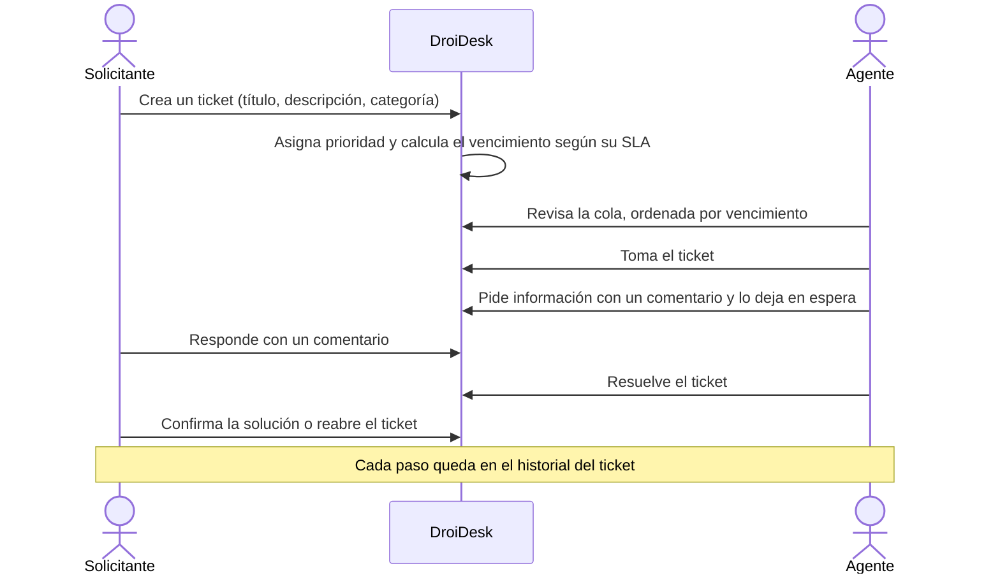
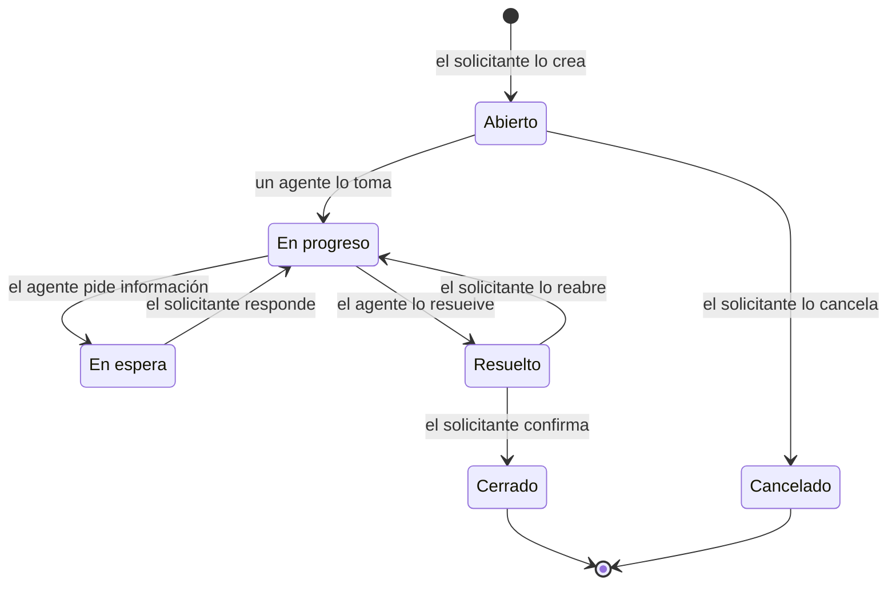

# Mission: DroiDesk

> Sistema de tickets de soporte para una organización de ~800 personas. Enunciado: [REQUIREMENTS.md](../REQUIREMENTS.md).

## Overview & Motivation

Hoy las solicitudes de soporte viven repartidas entre correo y planillas: nadie sabe cuántas hay abiertas, cuánto demoran ni quién las tiene. DroiDesk es la primera versión de un único lugar donde:

- el **solicitante** registra su problema y sigue su avance sin escribir correos;
- el **agente de soporte** ve una cola ordenada por urgencia, toma tickets y los lleva hasta su resolución;
- cada cambio queda registrado: **qué pasó, quién lo hizo y cuándo**.

**Identidad.** DroiDesk toma como referencia visual a un droide astromecánico, el ayudante que diagnostica y repara sin hacer ruido. Esa metáfora guía el tono de la interfaz: clara, confiable y con luces que indican el estado de cada ticket.

## Actors

| Actor | Quién es | Qué necesita |
|---|---|---|
| Solicitante | Cualquier persona de la organización | Pedir ayuda, saber en qué estado está su pedido y responder cuando le preguntan algo |
| Agente de soporte | Persona del equipo de soporte | Saber qué atender primero, tomar tickets, conversar con el solicitante y cerrar el ciclo |

## Core Workflow

### Ciclo de vida del ticket

Confirmado en Clarify de la feature 001; quién mueve cada transición y cómo afecta al SLA está en su [spec](001-ticketing-mvp/spec.md#clarifications).

## Scope (MVP vs. Deferred)

### MVP

| # | Capacidad | Origen |
|---|---|---|
| 1 | Crear un ticket con título, descripción y categoría | Obligatorio 1 |
| 2 | Cola de tickets para agentes: tomar uno y cambiar su estado | Obligatorio 2 |
| 3 | Historial por ticket: qué pasó, quién y cuándo | Obligatorio 3 |
| 4 | Dos perfiles con vistas distintas: solicitante y agente | Obligatorio 4 |
| 5 | SLA por prioridad: plazo comprometido, vencimiento visible y cola ordenada por urgencia | Opcional elegido |
| 6 | Comentarios en el ticket | Opcional elegido |
| 7 | Ingreso simulado: login con usuarios precreados por perfil y cualquier contraseña, con una ayuda que los lista | Definición propia, revisada por el usuario |
| 8 | Levantar todo con un solo comando | Definición propia |

### Deferred

| Capacidad | Destino |
|---|---|
| Adjuntos, notificaciones, reasignación, dashboard de métricas, búsqueda, categorización automática | Descartadas del alcance opcional ([criterio](../DECISIONS.md#alcance-opcional)). Los filtros por prioridad y estado del SLA se sumaron como complemento del SLA (FR-024a) |
| Autenticación real, varias áreas de soporte, feriados en el calendario del SLA, cierre automático de tickets resueltos | Plan de escalabilidad ([roadmap](roadmap.md), fase 10) |

## Success Metrics

| ID | Métrica | Meta |
|---|---|---|
| SM-01 | Visibilidad | En cualquier momento se sabe cuántos tickets hay abiertos, quién tiene cada uno y si está dentro de su plazo, sin salir de DroiDesk |
| SM-02 | Trazabilidad completa | El 100 % de los cambios de un ticket (estado, asignación, prioridad y comentarios) queda en su historial con autor y momento |
| SM-03 | Pedir ayuda es rápido | Un solicitante crea un ticket en menos de 1 minuto |
| SM-04 | Foco del agente | Un agente identifica el ticket más urgente en menos de 10 segundos al abrir la cola |
| SM-05 | Cumplimiento medible | El porcentaje de tickets resueltos dentro de su SLA se puede calcular con los datos registrados |
| SM-06 | Puesta en marcha | Una persona sin contexto previo levanta la aplicación con un solo comando en menos de 5 minutos |
