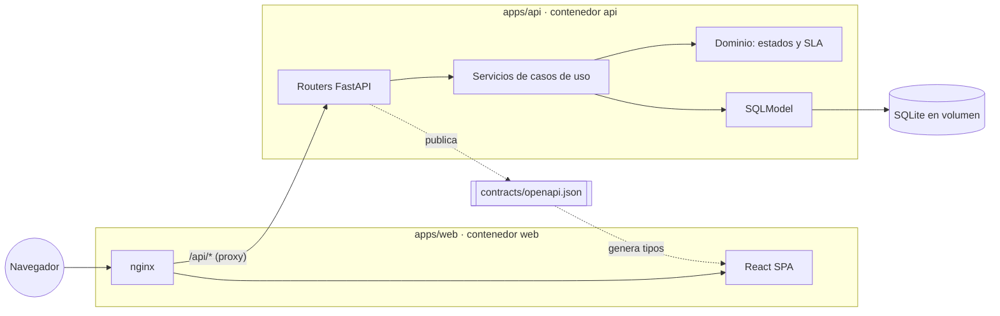
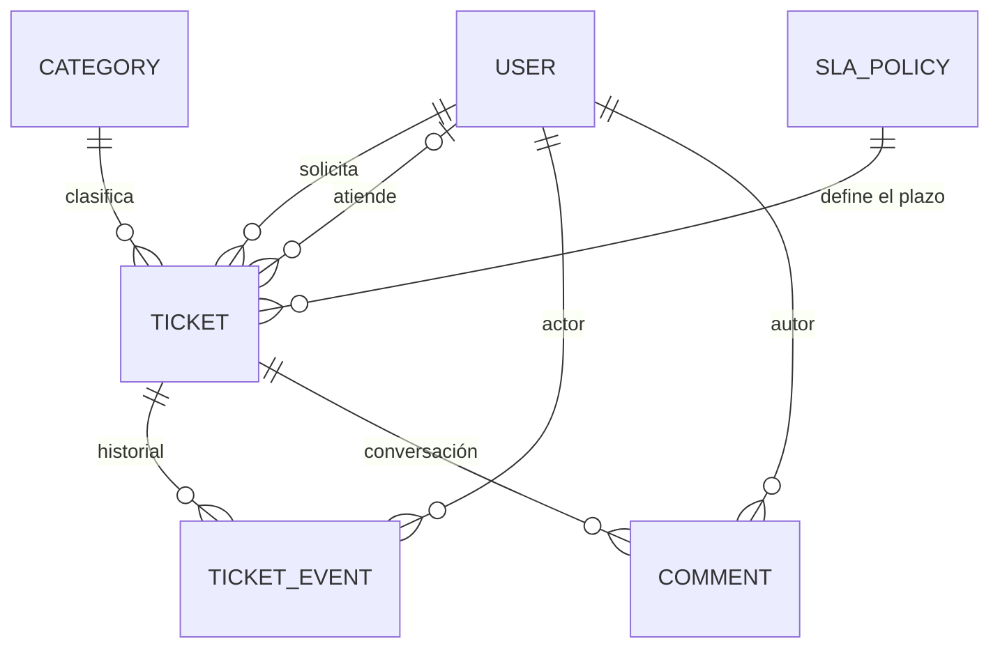

# Tech Stack & Architecture: DroiDesk

Las decisiones de fondo están en los ADL de [`.design-logs/`](../.design-logs/). Las versiones exactas, verificadas con context7, quedan en el `research.md` de cada feature.

## System Design & Component Architecture

DroiDesk es un monorepo con **dos aplicaciones independientes**, cada una con sus dependencias, Dockerfile, tests y pipeline. Solo se comunican por HTTP, a través de un contrato OpenAPI versionado ([ADL-001](../.design-logs/ADL-001-two-apps-openapi-contract.md)).



| Componente | Responsabilidad | Lo que no hace |
|---|---|---|
| `apps/web` | Vistas por rol, estado de servidor, tema visual | Reglas de negocio: muestra lo que la API permite |
| `apps/api` | Reglas de negocio, autorización por rol, persistencia e historial | Renderizar interfaz |
| `contracts/openapi.json` | Única fuente de verdad de la interfaz entre ambas apps | — |

### Estructura del repositorio

```
droidesk/
├── apps/
│   ├── api/                  # FastAPI · uv · pytest
│   │   ├── src/droidesk_api/
│   │   │   ├── core/         # configuración, base de datos, seguridad
│   │   │   ├── identity/     # usuarios, ingreso simulado, roles
│   │   │   ├── tickets/      # tickets, transiciones y comentarios
│   │   │   ├── audit/        # historial append-only de eventos
│   │   │   └── sla/          # políticas por prioridad y vencimientos
│   │   ├── migrations/       # Alembic
│   │   └── tests/
│   └── web/                  # React · Vite · Vitest
│       └── src/
│           ├── app/          # rutas, providers y layout por rol
│           ├── api/          # cliente y tipos generados del contrato
│           ├── features/     # auth/, requester/, agent/, tickets/
│           └── ui/           # design system del droide
├── contracts/openapi.json
├── specs/                    # SDD
├── .design-logs/             # ADLs
├── docker-compose.yml
└── setup.sh                  # un comando: configura y levanta todo
```

### Capas de la API

**Router** (HTTP, validación y autorización) → **Servicio** (caso de uso y transacción) → **Dominio** (funciones puras: transiciones válidas, vencimientos y estado del SLA) y **Modelos** (SQLModel). El dominio no conoce FastAPI ni la base de datos, para probarlo con tests unitarios rápidos.

## Technology Stack & Configuration

| Capa | Tecnología | Por qué |
|---|---|---|
| Lenguaje de la API | Python 3.14 | Elegido por el usuario; las skills clean-code de Python aplican 1:1 en deckard |
| Framework de la API | FastAPI | Validación por tipos, inyección de dependencias para autorizar por rol y OpenAPI automático, que es el contrato entre apps ([ADL-002](../.design-logs/ADL-002-fastapi-sqlmodel-backend.md)) |
| ORM y modelos | SQLModel (SQLAlchemy + Pydantic) | Un solo modelo para la tabla y la validación: menos código |
| Migraciones | Alembic | Esquema versionado y el mismo camino para SQLite y PostgreSQL |
| Base de datos | SQLite en un volumen Docker | Pedido para el MVP, sin infraestructura extra; PostgreSQL en el plan de escalamiento ([ADL-003](../.design-logs/ADL-003-sqlite-mvp-postgres-path.md)) |
| Ingreso simulado | Token firmado (JWT) que se emite tras un login de usuarios precreados que acepta cualquier contraseña | Perfiles reales en cada request sin gestionar contraseñas; reemplazable por SSO ([ADL-005](../.design-logs/ADL-005-simulated-auth-signed-token.md)) |
| Dependencias de la API | uv (`pyproject.toml` + `uv.lock`) | Instalación reproducible y rápida |
| Calidad de la API | ruff (lint y formato), mypy, pytest con cobertura | Gates del checkpoint de bloque |
| Lenguaje de la web | TypeScript 6 estricto | Tipos del contrato hasta la interfaz; TypeScript 7 todavía no lo soportan las herramientas de generación de tipos |
| Interfaz | React + Vite, como SPA | Una app interna detrás de un ingreso no necesita SSR ([ADL-004](../.design-logs/ADL-004-react-vite-spa.md)) |
| Ruteo | React Router 8 (modo data) | Rutas por rol, con las guardas como middleware |
| Estado de servidor | TanStack Query | Caché, recarga e invalidación tras tomar o cambiar un ticket, sin código propio |
| Cliente HTTP | openapi-typescript + openapi-fetch + openapi-react-query | Tipos y hooks generados desde `contracts/openapi.json`: si el contrato cambia, la web no compila |
| Estilos | CSS Modules + tokens CSS | Tema del droide sin librerías de componentes |
| Calidad de la web | Biome (lint y formato), `tsc -b`, Vitest + Testing Library | Gates del checkpoint de bloque; versiones exactas en el [research de la feature 001](001-ticketing-mvp/research.md) |
| Contenedores | Docker Compose: `api` (uvicorn) y `web` (nginx con la SPA y proxy de `/api`) | Mismo origen en el navegador, sin CORS ([ADL-006](../.design-logs/ADL-006-docker-compose-same-origin.md)) |
| CI | GitHub Actions: un workflow por app, con filtro de rutas, más un chequeo del contrato | Las apps también son independientes en CI |

### Configuración

| Variable | App | Valor por defecto | `setup.sh` |
|---|---|---|---|
| `DROIDESK_JWT_SECRET` | api | — | Lo genera automáticamente |
| `DROIDESK_DATABASE_URL` | api | `sqlite:////data/droidesk.db` | No lo pide |
| `DROIDESK_SEED_DEMO_DATA` | api | `true` | Pregunta si cargar datos de demo |
| `DROIDESK_TIMEZONE` | api | `America/Santiago` | Pregunta la zona horaria de la organización, que define el calendario del SLA |
| `DROIDESK_BUSINESS_HOURS` | api | `09:00-18:00` | Pregunta la jornada hábil, de lunes a viernes |
| `DROIDESK_WEB_PORT` | compose | `8080` | Pregunta el puerto |

## Data Layer (Schema) & API Reference

Resumen; el detalle de campos y validaciones vive en el `data-model.md` de la feature 001.



| Entidad | Propósito | Campos clave |
|---|---|---|
| `User` | Persona que usa DroiDesk | nombre, email, rol (`requester` o `agent`) |
| `Category` | Clasificación que elige el solicitante | nombre |
| `SlaPolicy` | Plazo de resolución por prioridad, en tiempo hábil | prioridad, minutos hábiles objetivo |
| `Ticket` | Estado actual de una solicitud | título, descripción, categoría, prioridad, estado, solicitante, agente asignado, vencimiento y fechas del ciclo |
| `TicketEvent` | Historial append-only: qué pasó, quién y cuándo | ticket, actor, tipo, valor anterior, valor nuevo y fecha |
| `Comment` | Mensaje en la conversación del ticket | ticket, autor, texto y fecha |

`Ticket` guarda el estado actual, para consultar la cola rápido. `TicketEvent` guarda la historia y nunca se edita ni se borra. Cada cambio en un ticket y su evento se escriben en la misma transacción. Las fechas se guardan en UTC.

| Método | Ruta | Rol | Propósito |
|---|---|---|---|
| GET | `/api/health` | público | Salud del servicio |
| GET | `/api/v1/auth/users` | público | Usuarios de demo (username, nombre y perfil) para la ayuda del login |
| POST | `/api/v1/auth/login` | público | Ingreso simulado: acepta cualquier contraseña de un usuario existente y emite el token |
| GET | `/api/v1/me` | ambos | Perfil del usuario actual |
| GET | `/api/v1/categories` | ambos | Categorías |
| GET | `/api/v1/sla-policies` | ambos | Prioridades y sus plazos |
| POST | `/api/v1/tickets` | solicitante | Crear un ticket |
| GET | `/api/v1/tickets` | ambos | Solicitante: sus tickets. Agente: la cola, con vistas fijas (cola completa y asignados a mí) |
| GET | `/api/v1/tickets/{id}` | ambos | Detalle con historial, comentarios y acciones permitidas para quien consulta |
| PATCH | `/api/v1/tickets/{id}` | agente | Ajustar la prioridad |
| POST | `/api/v1/tickets/{id}/transitions` | según la acción | Tomar, cancelar, dejar en espera, retomar, resolver, cerrar o reabrir; la API valida el estado, el rol y la relación con el ticket |
| POST | `/api/v1/tickets/{id}/comments` | ambos | Comentar |

El solicitante solo ve y comenta sus propios tickets. El contrato completo vive en `contracts/openapi.json`.

## Processing Pipelines / Workflows

1. **Crear ticket**: validar, asignar prioridad, calcular el vencimiento en tiempo hábil (política de SLA más calendario de lunes a viernes en la jornada configurada) y guardar el ticket junto con el evento `CREATED`, en una transacción.
2. **Tomar ticket**: solo si está `OPEN` y sin asignar. Asigna al agente, lo pasa a `IN_PROGRESS` y registra los eventos. Si otro agente lo tomó antes o el solicitante lo canceló, responde conflicto: la asignación es una actualización condicional y atómica.
3. **Cambiar estado**: la máquina de estados del dominio decide si la transición es válida para ese rol. La API devuelve en cada ticket las acciones permitidas, para que la web no duplique la regla.
4. **Comentar**: guarda el comentario y su evento. Si comenta el solicitante de un ticket En espera, el ticket vuelve a En progreso en la misma transacción y el plazo se reanuda.
5. **Estado del SLA**: en plazo, por vencer, vencido o en pausa, y cumplido o incumplido una vez resuelto. Se calcula al leer, a partir del vencimiento y del tiempo en espera; no se guarda, para que nunca quede desactualizado.

## Visual Identity

Referencia: un droide astromecánico. Todo el arte es propio, en SVG, sin logos ni material oficial de terceros.

| Token | Valor | Uso |
|---|---|---|
| `--color-hull` | `#F4F6FA` | Fondo (casco blanco) |
| `--color-panel` | `#FFFFFF` | Tarjetas y paneles |
| `--color-astro-blue` | `#1D4E9E` | Primario: acciones y encabezados |
| `--color-astro-blue-soft` | `#E3ECFA` | Selección y fondos suaves |
| `--color-silver` | `#C7CFDB` | Bordes y líneas de panel |
| `--color-ink` | `#0F1B2D` | Texto |
| `--color-ink-muted` | `#5B6B82` | Texto secundario |
| `--light-ok` | `#2F9E6A` | Luz verde: en plazo |
| `--light-warn` | `#E0A100` | Luz ámbar: por vencer |
| `--light-alert` | `#D64545` | Luz roja: vencido |
| `--light-holo` | `#4CC3E8` | Foco y acentos (holoproyector) |

- **Formas**: paneles redondeados con líneas finas tipo placa; indicadores circulares, como las luces del droide, para el estado y el SLA.
- **Tipografía**: pila del sistema para el texto; títulos en mayúsculas con espaciado amplio, para el tono técnico.
- **Tono**: microcopy con una personalidad leve en los estados vacíos ("Bip-bup: la cola está despejada").
- **Accesibilidad**: contraste AA y foco visible. El estado nunca se comunica solo con color: cada luz va con su texto.

## Quality Strategy

El esfuerzo de testing sigue la ley de Pareto: el 20 % del código que concentra el riesgo, el **flujo crítico**, se exige más que el resto ([ADL-007](../.design-logs/ADL-007-pareto-coverage-gates.md)).

**Flujo crítico**: el ciclo de vida del ticket (crear → tomar → cambiar estado → historial), con sus reglas de SLA y la autorización por rol.

| Nivel | Qué se prueba | Herramienta |
|---|---|---|
| Dominio | Transiciones válidas e inválidas por rol, vencimientos y estado del SLA, con sus bordes | pytest (unitario) |
| API | Cada endpoint: autorización por rol, validación, historial escrito y conflicto al tomar | pytest + TestClient con SQLite temporal |
| Web | Guardas por rol, formulario de creación, cola y toma de tickets, acciones según lo que permite la API, luces de estado y SLA | Vitest + Testing Library |
| Contrato | El OpenAPI versionado coincide con el que genera la API | CI |
| End-to-end | El recorrido principal sobre el stack Docker | Un smoke test; la herramienta se define en la fase de empaquetamiento |

### Coverage gates

| Alcance | Meta (líneas) | Cómo se mide |
|---|---|---|
| Total de cada app (`apps/api`, `apps/web`) | ≥ 80 % | pytest-cov con `--cov-fail-under=80`; Vitest con un umbral global de 80 |
| Flujo crítico de la API: `tickets/`, `sla/`, `audit/` e `identity/authorization.py` | ≥ 90 % | Un segundo reporte de coverage limitado a esas rutas, con `--fail-under=90` |
| Flujo crítico de la web: `src/features/` | ≥ 90 % | Umbral por glob en la configuración de coverage de Vitest |

Las rutas exactas se ajustan en el `plan.md` de la feature 001 si la estructura cambia; el criterio no. Fuera del foco quedan los estilos, los componentes puramente visuales, la configuración y el arranque, y el comportamiento interno de librerías de terceros: los cubre el 80 % total.

## Security (MVP)

- La API autoriza por rol en cada endpoint, usando el rol guardado en la base de datos y no uno enviado por el cliente.
- Toda entrada se valida con largos máximos.
- Descripciones y comentarios se muestran como texto plano, nunca como HTML.
- El secreto del token lo genera `setup.sh` en un `.env` que no se versiona.
- El ingreso simulado acepta cualquier contraseña de un usuario precreado, y la contraseña nunca se guarda ni se registra: es aceptable solo en el MVP y queda como deuda técnica explícita ([ADL-005](../.design-logs/ADL-005-simulated-auth-signed-token.md)).
